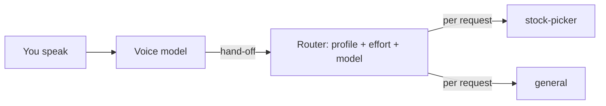
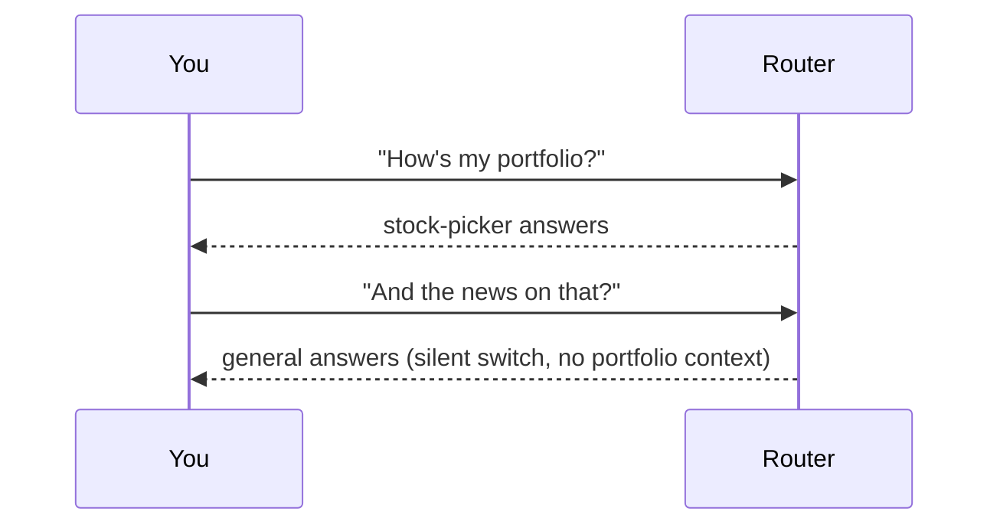

# Master Plan Amendment: Active Profile and Profile Voice Context

Created: 2026-11-04
Status: draft
Amends: master-plan.md (spec voice-router-discord); lands as a revision to draft PR robsgreen/hermes-duplex#1

---

## ABOVE THE LINE — Design Narrative

### Background

Today the router picks a Hermes profile for every hand-off. It keeps a sticky "current profile" per speaker, but it leaves that profile silently when another one scores higher. A **profile** is a separate Hermes agent with its own memory, tools and persona (for example `stock-picker` or `general`). The **voice model** is the realtime speech model that talks to you and hands work to Hermes.



### The Problem

**Silent switching.** You hold one conversation, but the backend agent behind it can change between two sentences. Each profile has its own memory, so context you built with one agent is missing from the next. It feels like talking to several people at once.



**Guessing.** Every routing guess can be wrong, and the reviews kept finding wrong-guess edge cases (ordinal words, shared words, stale context).

**A generic voice.** The voice model knows only a one-line description of each profile. It cannot talk about a domain well or judge what to hand off for it.

### The Design

You talk to one assistant, with one **active profile** at a time. It starts at your default profile and stays until you ask to switch. Every switch is explicit, spoken back to you, and remembered across conversations.

```mermaid
stateDiagram-v2
  [*] --> Default: first conversation
  Default --> StockPicker: "switch to stock-picker" / /duplex profile / web picker
  StockPicker --> General: "back to general"
  StockPicker --> StockPicker: hand-offs go here
  note right of StockPicker: saved per person, survives restarts
```

**Switching.** You can switch in three ways:
- by voice ("let me talk to stock-picker", "back to general");
- with the Discord command `/duplex profile <name>`;
- with a picker on the web page.

The assistant confirms every switch out loud ("Okay, you're now talking to stock-picker."). A switch to a profile you may not use is refused, with the same notice as today. Profiles can have spoken aliases in config, such as "stocks" or "the stock picker".

**Hand-offs.** Every task goes to your active profile, using one Hermes session per person and profile, as today.

**The router's new job.** It no longer picks the profile. It has two remaining jobs:
1. **Effort and model:** it picks the effort for the active profile, and the model comes from that profile's effort table, as today.
2. **Switch suggestions (optional):** when a request clearly belongs to another profile that you may use, the assistant asks before handing it off ("That sounds like a stock-picker question. Want me to switch?").
   - "Yes" switches and runs the request there.
   - Anything else runs it on the active profile.
   - It never switches on its own, and config can turn suggestions off.

```mermaid
sequenceDiagram
  participant You
  participant Voice
  participant Session
  participant Router
  participant Hermes
  You->>Voice: "what did NVDA do today?"
  Voice->>Session: hand-off
  Session->>Router: effort? better profile?
  Router-->>Session: effort low; stock-picker clearly better (active: general)
  Session->>Voice: ask "Want me to switch to stock-picker?"
  You->>Voice: "yes"
  Session->>Session: active = stock-picker (saved), voice context updated
  Session->>Hermes: run on /p/stock-picker
```

**Profile voice context.** Each profile can carry a short `voice_context` in `duplex.yaml`:
- what it covers;
- what the voice may answer itself and what to always hand off ("always delegate prices; never quote one from memory");
- vocabulary and pronunciation;
- rules ("confirm before any trade request").

Each provider's prompt strategy places it in its own format. On a switch, the voice model's instructions change too:

| Provider | On switch |
|---|---|
| OpenAI Realtime, xAI Grok | Replace the instructions with `session.update`, re-rendered for the new active profile. |
| GPT-Live | Append the new profile's context with `session.instructions.append` (500 tokens each, split if longer). Once appended switch context passes a budget, restart the session with fresh instructions and the existing reconnect summary. |

The session chooses between these by provider capability, never by provider name.

### Non-Goals

- **Automatic switching.** Suggestions only; the user always decides.
- **Reading a Hermes profile's own `SOUL.md` or skills.** That would need Hermes internals, so the voice context lives in our config.
- **A different voice or persona per profile.** The assistant keeps one voice and name.
- **Several active profiles at once,** for example a group call where each person uses a different profile. The active profile is per person, so this works anyway; the persona stays the same.

### Alternatives & Trade-offs

**Keep per-request routing.** Rejected. It switches silently, fragments context across profiles, and produced a steady stream of wrong-guess edge cases.

**Strict explicit switching with no router.** Rejected as the default. It is simpler, but loses effort selection and the helpful "want me to switch?". It stays available: `suggest_switch: false` plus effort from config.

**Ask the voice model to choose the profile through a tool argument.** Rejected. It has no calibrated confidence, it bloats the tool schema, and GPT-Live has no tools.

What we accept:
- one extra step ("switch to stock-picker") before cross-domain questions, softened by suggestions;
- on GPT-Live, an occasional brief session restart after many switches.

### How We Get There

One milestone, built on the current branch:
1. Active-profile store and switching (voice intent, tool, Discord command, web picker), with permissions and spoken confirmation.
2. Router reduced to effort plus switch suggestions; dispatch to the active profile.
3. `voice_context` config and prompt rendering per provider; instruction update on switch (replace or append-and-restart).
4. The pending round-7 fixes on topic task resolution.
5. Docs, live checklist and tests, then scoped review and a revision push to PR #1.

### Risks & Open Questions

- **Voice recognition of a switch.** Recognising "switch to X" must not hand the request off as a task. GPT-Live has no tools, so the switch intent goes through the router's control path, like status and cancel today. Realtime and Grok get a `switch_profile` tool.
- **Suggestion latency.** The suggest check runs on the same router call as effort, under the existing deadline, so it adds no extra round trip.
- **GPT-Live append limits.** These are 500 tokens per append and 16k for the whole instructions. A restart loses unsummarised context, which the reconnect summary covers.
- **Stale active profile.** If a person's saved active profile is removed from config, or they lose permission for it, they fall back to their default with a spoken notice.
- [ ] Open (user): the round-7 single-open-task cancel decision (ask when the words name a different topic, or cancel anyway). This amendment carries a default of **ask**, pending your answer.

---

## BELOW THE LINE — Execution Spec

### Scope

```
Files to create:
- hermes_duplex/profiles.py — ActiveProfiles store: per-person active profile, default resolution, persistence ($HERMES_HOME/duplex/active_profiles.json, atomic write), permission-aware switch()

Files to modify:
- hermes_duplex/config.py — profiles.<p>.voice_context (str, ≤ 2000 chars), profiles.<p>.aliases (list[str]); people.<p>.default_profile (optional, must be permitted); router.suggest_switch (bool, default true), router.suggest_threshold (0<x≤1, default 0.85); remove router.sticky_idle_s (reject with a migration message)
- hermes_duplex/router/composite.py, router/base.py, router/decisions.py, router/jev.py, router/knn.py, router/eval.py — route(text, speaker, active_profile, permitted, history) → RouteDecision(effort, model, suggestion: str|None, control_intent incl. "switch", switch_target: str|None); remove sticky state; keep deadline/breaker/fallback for effort; eval reports effort + suggestion accuracy
- hermes_duplex/session.py — dispatch to active profile; switch handling (control intent, switch_profile tool, transport command); pending-suggestion state per speaker (yes → switch+run, else run on active; expires after one turn or 30 s); instruction update on switch via capability; round-7 fixes
- hermes_duplex/providers/base.py — ProviderCapabilities.replaces_instructions (bool); RealtimeProvider.update_instructions(text) (Realtime/Grok: session.update instructions; GPT-Live: raises/not used) and append_instructions(text) (GPT-Live: session.instructions.append split ≤500 chars; others unused)
- hermes_duplex/providers/gpt_live/{adapter,prompt}.py, providers/realtime/{adapter.py, openai/prompt.py, xai/prompt.py}, providers/fake/adapter.py — active-profile section + voice_context rendering; profile_switch(ctx) text for appends; switch_profile tool (Realtime/Grok) with profile + aliases listed
- hermes_duplex/prompts/{base,blocks,notices}.py — PromptContext.active_profile, voice_context; notices: switched_to(profile), switch_refused(profile), suggest_switch(profile), fallback_to_default(profile), already_active(profile)
- hermes_duplex/transports/discord/bot.py — /duplex profile <name> (autocomplete permitted profiles)
- hermes_duplex/transports/web/{server.py, static/*} — profile picker; control frame {"type":"profile","name":...}; status frame includes active profile
- hermes_duplex/service.py, plugin.py — wire ActiveProfiles; /duplex status shows each person's active profile
- duplex.example.yaml, README.md, AGENTS.md, docs/system/architecture.md, docs/live-checklist.md
- tests/** — unit, contract, e2e, goldens (new golden context includes an active profile with voice_context)

Off-limits: Hermes internals; tasks.jsonl format (tasks already record their profile).
```

### Requirements

MUST: Keep one active profile per person, defaulting to `people.<p>.default_profile`, else `router.default_profile` if permitted, else the person's first permitted profile; persist it across conversations and restarts.
- Unit tests: default resolution; persistence round trip; corrupt or missing file → defaults (logged), never blocks start; a removed or no-longer-permitted saved profile → default plus `fallback_to_default` notice on next conversation.

MUST: Switch only on explicit request: voice (control intent "switch" with a target resolved from profile names and aliases), the Realtime/Grok `switch_profile` tool, Discord `/duplex profile`, or the web picker. Confirm aloud.
- Tests: "switch to stock-picker" / "let me talk to the stock picker" / "back to general" → switch and `switched_to`; an unknown target → asks which (lists permitted profiles); a non-permitted target → `switch_refused`, active unchanged; switching to the active profile → `already_active`; a switch never creates a Hermes task.

MUST: Dispatch every hand-off to the speaker's active profile (session `duplex-{person}-{profile}` as today); permission is checked against the active profile at dispatch.
- Tests: the e2e portfolio flow switches to stock-picker first, then runs on `/p/stock-picker`; no request runs on a profile other than the active one or one the user just confirmed.

MUST: The router decides effort (and model via the active profile's table) and an optional switch suggestion; it never changes the active profile.
- Suggestion only when `router.suggest_switch` is true, the best other permitted profile's probability ≥ `suggest_threshold`, and it beats the active profile's by ≥ 0.2; otherwise none.
- On a suggestion the session holds the request and asks `suggest_switch(profile)`. The next utterance from the same speaker that is an affirmative ("yes", "sure", "switch") switches and runs the held request on the new profile; anything else runs the held request on the active profile and then is handled normally. A pending suggestion expires after 30 s, and the held request then runs on the active profile.
- Tests: confident other profile → ask; "yes" → switch + run there; "no" → run on active; timeout → run on active; suggest off → run on active with no question; not-permitted other profile → never suggested.

MUST: Per-profile `voice_context` (optional, ≤ 2000 chars) is rendered by each prompter as an "active profile" section (name, description, voice_context) in its vendor format; no other profile's voice_context appears in the prompt.
- Golden tests per provider with an active profile carrying voice_context; a structural test that the voice_context appears exactly once and only for the active profile.

MUST: On a switch, update the voice model's instructions according to capability: `replaces_instructions` → `update_instructions(prompter.instructions(ctx))`; otherwise `append_instructions(prompter.profile_switch(ctx))`, split into ≤500-char parts. When the appended switch context since the last session start exceeds 1500 chars or 3 switches, restart the provider session with fresh instructions and the reconnect summary (reusing the reconnect path, without counting as a failure).
- Contract tests: Realtime/Grok send `session.update` with the new instructions; GPT-Live sends `session.instructions.append` parts; the budget triggers a clean restart with the new instructions; running Hermes tasks continue across it.

MUST: Apply the round-7 fixes: filler words for ordinals/recency/contractions/"never mind" (and keep "news" intact); strip polite lead-ins in `topic`; `NO_SUCH_TASK` when a resolved task is not open but others are; docstring fix; the single-open-task cancel asks unless the words carry no topic words or overlap it (pending user decision; default ask).
- Tests per review round 7.

SHOULD: `/duplex status` and the web status frame show each person's active profile; the web page shows a picker of permitted profiles.

### Interfaces

```python
# hermes_duplex/profiles.py
class ActiveProfiles:
    def __init__(self, path: Path, permissions: PermissionChecker, default_for: Callable[[str], str]) -> None: ...
    def get(self, person: str) -> str: ...
    async def switch(self, person: str, profile: str) -> SwitchResult: ...   # switched | already_active | refused | unknown
    def load(self) -> list[tuple[str, str]]: ...  # (person, fallback profile) pairs that needed a fallback

# router/base.py
@dataclass(frozen=True)
class RouteDecision:
    effort: Effort; model: ModelChoice | None
    suggestion: str | None            # a better permitted profile, or None
    control_intent: Literal["status", "cancel", "switch"] | None
    switch_target: str | None         # for control_intent == "switch"
    probabilities: Mapping[str, float]; source: RouteSource; latency_ms: int

# providers/base.py
class ProviderCapabilities(TypedDict):  # adds
    replaces_instructions: bool
class RealtimeProvider(Protocol):       # adds
    async def update_instructions(self, text: str) -> None: ...
    async def append_instructions(self, text: str) -> None: ...

# prompts/base.py
@dataclass(frozen=True)
class PromptContext:                    # adds
    active_profile: str | None
    voice_context: str | None
class VoicePrompter(Protocol):          # adds
    def profile_switch(self, ctx: PromptContext) -> str: ...
```

```yaml
profiles:
  stock-picker:
    description: Portfolio, holdings, stock research, trades
    aliases: [stocks, the stock picker, portfolio]
    voice_context: |
      Covers the user's portfolio, holdings, market data and trades.
      Always hand off prices, positions, and anything time-sensitive; never quote a number from memory.
      Say tickers letter by letter (NVDA as N-V-D-A).
      Confirm before handing off any request to buy or sell.
people:
  rob: {discord_id: "123", web_token_env: DUPLEX_TOKEN_ROB, profiles: ["*"], default_profile: general}
router:
  suggest_switch: true
  suggest_threshold: 0.85
```

### Error Handling & Edge Cases

| Scenario | Expected Behavior | Recovery |
|---|---|---|
| Saved active profile removed from config or permission lost | Use default; speak `fallback_to_default` on next conversation | Saved value replaced |
| active_profiles.json corrupt/unreadable | Defaults for everyone; log error | Rewritten on next switch |
| Switch target unknown / ambiguous | Ask which, listing permitted profiles by name | — |
| Switch to non-permitted profile | `switch_refused`; active unchanged | — |
| Suggestion pending and speaker says something unrelated | Run held request on active profile, then handle the new utterance | — |
| Two people in one call with different active profiles | Each person's hand-offs go to their own active profile; prompt shows the active profile of the person who last switched | Documented limitation |
| update_instructions fails (Realtime/Grok) | Log; keep previous instructions; spoken notice not required | Retried on next switch |
| GPT-Live append rejected | Restart session with fresh instructions | Reconnect path |

### Test Strategy

| Level | Included | Rationale |
|---|---|---|
| Unit | Yes | ActiveProfiles, config, router suggestion/effort, session switch/suggest flows, prompt rendering |
| Contract | Yes | provider instruction updates (session.update / instructions.append / restart) |
| E2E (real Hermes) | Yes | switch then delegate lands on the switched profile; default profile run |
| Live/manual | Yes | live-checklist: voice switch, suggestion, voice_context effect per provider |

Commands: as in master-plan Test Strategy (`uv run pytest -m "not live and not e2e"`, `-m e2e` with the Hermes venv on PATH).

### Research Findings

- GPT-Live: instructions are set at session start (≤16,384 tokens); mid-session changes only via `session.instructions.append` (≤500 tokens per event, `delegation_id: null` for session-wide). Source: developers.openai.com/api/docs/guides/live-conversations (local copy oa/live-conversations.md lines 20–26, 199–215).
- OpenAI Realtime and xAI Grok: `session.update` may set `instructions` at any time. Sources: Realtime guides (oa/realtime-conversations.md); docs.x.ai speech-to-speech (xai/s2s.md line 148), prompting guide (r2/xai-pg.md line 5).
- Existing code: CompositeRouter sticky state (router/composite.py), `_resolve_task` (session.py), the reconnect + reseed path (session._reconnect, prompts.blocks.history_summary), per-provider prompters (providers/*/prompt.py).
- User decisions: research-decisions.md (architecture A, voice context included).
