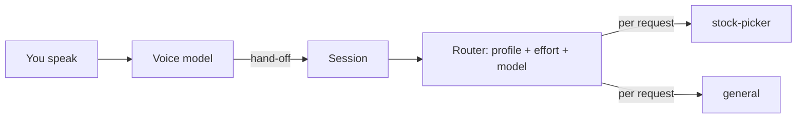
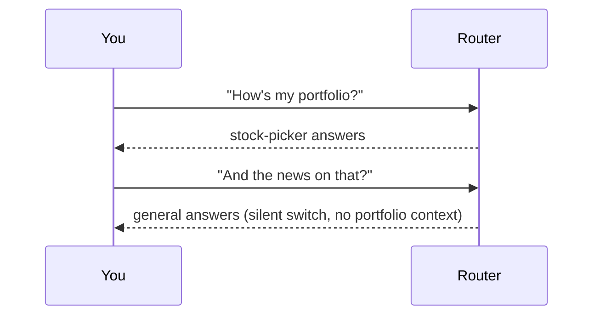
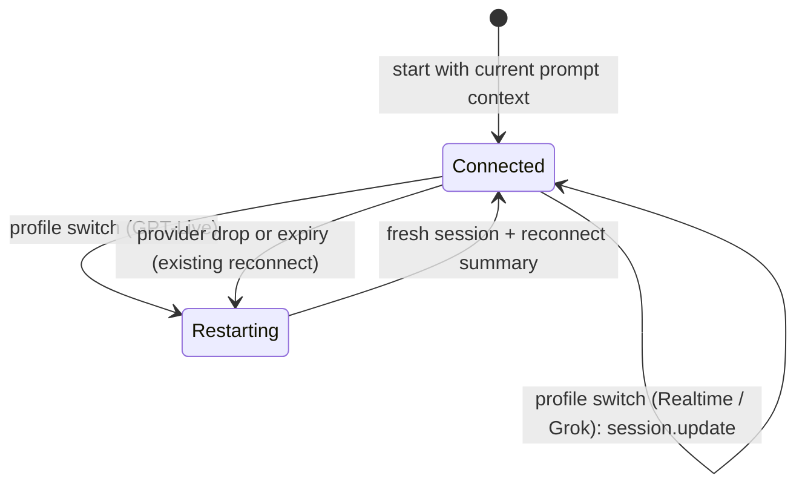
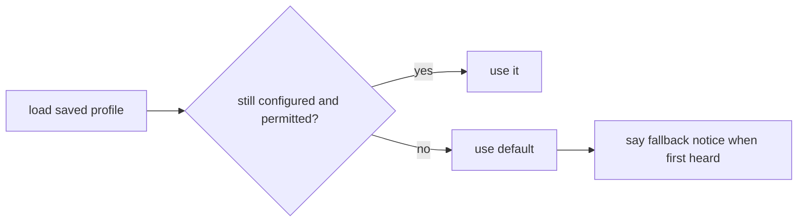

# Master Plan Amendment: Active Profile and Profile Voice Context

Created: 2026-11-04
Status: draft (revised after plan review)
Amends: master-plan.md (spec voice-router-discord); lands as a revision to draft PR robsgreen/hermes-duplex#1

---

## ABOVE THE LINE — Design Narrative

### Background

Today the router picks a Hermes profile for every hand-off. It keeps a sticky "current profile" for each speaker, but it leaves that profile silently when another one scores higher.

A **profile** is a separate Hermes agent with its own memory, tools and persona, for example `stock-picker` or `general`. The **voice model** is the realtime speech model that talks to you and hands work to Hermes. The **session** is our code that sits between the two.



### The Problem

**Silent switching.** You hold one conversation, but the backend agent can change between two sentences. Each profile has its own memory, so context you built with one is missing from the next. It feels like talking to several people at once.



**Guessing.** Every routing guess can be wrong. Review after review found wrong-guess edge cases: ordinal words, shared words, stale context.

**A generic voice.** The voice model knows one line about each profile. It cannot talk about a domain well or judge what to hand off for it.

### The Design

You talk to one assistant, with one **active profile** at a time.
- It starts at your default profile.
- It stays until you ask to switch.
- Every switch is explicit, confirmed out loud, and saved across conversations and restarts.

```mermaid
stateDiagram-v2
  [*] --> Default: first conversation
  Default --> StockPicker: switch request (voice, tool, /duplex profile, web picker)
  StockPicker --> General: "back to general"
  StockPicker --> StockPicker: hand-offs go here
  note right of StockPicker: saved per person
```

#### Switching

You can switch four ways:
- **By voice:** "switch to stock-picker", "let me talk to the stock picker", "back to general".
- **Discord:** `/duplex profile <name>`.
- **Web:** the picker on the page.
- **Realtime and Grok:** the voice model calls a `switch_profile` tool when you ask.

Our session decides what a voice switch request means, never the router.
- **How it matches:** it checks the hand-off text for a switch phrase ("switch to", "talk to", "back to", "change to") followed by a profile's name or one of its spoken aliases from config.
- **Where it runs:** before routing, so a switch is never handed to Hermes as a task.
- **GPT-Live:** has no tools, so its prompt tells it to hand off any request to change who you talk to.

A switch to a profile you may not use is refused with the same notice as today.

```mermaid
sequenceDiagram
  participant You
  participant Voice
  participant Session
  participant Store as Active profiles
  You->>Voice: "let me talk to the stock picker"
  Voice->>Session: switch_profile("stock-picker") / hand-off text
  Session->>Session: match name or alias; check permission
  Session->>Store: save rob -> stock-picker
  Store-->>Session: notify live sessions for rob
  Session->>Voice: new instructions for stock-picker
  Session->>Voice: say "You're now talking to stock-picker."
```

Discord and web switches go to the same store. The store notifies every live conversation for that person, which then updates its voice instructions and confirms out loud. With no live conversation, the switch is only saved, and Discord replies privately in text.

#### Which profile the voice prompt describes

Each conversation holds its own **current prompt context**, used on every connect and reconnect:
- **Web page:** from the start, the signed-in person's active profile.
- **Discord:**
  - **At connect:** the default profile.
  - **When a person is first heard:** their active profile, if it differs.
  - **Later:** the profile of whoever switched last.

Hand-offs always go to the speaker's own active profile, whatever the prompt shows.

#### Hand-offs and the router's new job

Every task goes to the speaker's active profile, with one Hermes session per person and profile as today. The router no longer picks a profile. It does two things:
1. **Effort:** it picks the effort, and the model comes from the active profile's effort table.
2. **Switch suggestion (optional):** when a request clearly belongs to another profile you may use, it flags that.

When the router suggests a switch, the session holds the request and asks: "That sounds like a stock-picker question. Want me to switch?" Your answer comes back through a channel the session can see:
- **Realtime and Grok:** the voice model calls `confirm_switch(accept)`.
- **GPT-Live:** its prompt tells it to hand off your yes or no. The session recognises a short yes/no answer while a question is pending for that speaker.

The outcomes:
- **Yes:** switch, then run the held request on the new profile.
- **No:** run it on the active profile.
- **No answer within 30 seconds:** run it on the active profile.

Nothing switches on its own, and `router.suggest_switch: false` turns suggestions off.

```mermaid
sequenceDiagram
  participant You
  participant Voice
  participant Session
  participant Router
  participant Hermes
  You->>Voice: "what did NVDA do today?"
  Voice->>Session: delegate(task)
  Session-->>Voice: receipt {"status":"received"}
  Session->>Router: effort? better profile?
  Router-->>Session: effort low; stock-picker clearly better (active: general)
  Session->>Voice: say "That sounds like a stock-picker question. Want me to switch?"
  You->>Voice: "yes"
  Voice->>Session: confirm_switch(true) / hand-off "yes"
  Session->>Session: switch (saved), instructions updated
  Session->>Hermes: run held request on /p/stock-picker
```

The `delegate` receipt becomes `{"status":"received"}`, so the model is never told a task started before the session has decided. The prompts say that a start notice or a switch question follows.

#### Profile voice context

Each profile can carry a short `voice_context` in `duplex.yaml`. It covers:
- what the profile covers;
- what the voice may answer itself and what to always hand off ("always hand off prices; never quote one from memory");
- how to phrase domain words ("say tickers letter by letter");
- rules ("confirm before any trade request").

Each provider's prompt strategy places it in its own format. On xAI it is phrased as rules about the words spoken, not about sound, as xAI's guide asks. When the prompt context changes, the voice model's instructions change too:

| Provider | On a prompt-context change |
|---|---|
| OpenAI Realtime, xAI Grok | `session.update` with instructions re-rendered for the new profile. |
| GPT-Live | Start a fresh session with the new instructions and the existing reconnect summary. |

GPT-Live can only add to its startup instructions mid-call. It also silently drops those additions when it replaces its engine in a long call, so appending would let the voice drift back to the old profile. A fresh session costs about a second of pause per switch, but the profile context is always right.



The session chooses between these paths by provider capability, never by provider name.

#### Stale profiles

If your saved profile is removed from config, or you lose permission for it, you are moved back to your default. You hear "You're back on general" the next time you are heard.



### Non-Goals

- **Automatic switching.** The router only suggests; you always decide.
- **Reading a Hermes profile's own `SOUL.md` or skills.** That would need Hermes internals, so the voice context lives in our config.
- **A different voice or persona per profile.** The assistant keeps one voice and name.
- **A voice prompt that follows each speaker on a shared call.** The prompt shows one profile at a time (see Error Handling). Hand-offs still use each person's own profile.

### Alternatives & Trade-offs

- **Keep per-request routing.** Rejected. It switches silently, splits context across profiles, and kept producing wrong-guess edge cases.
- **Strict explicit switching with no router.** Rejected as the default. It loses effort selection and the "want me to switch?" prompt. It stays available as `suggest_switch: false`.
- **Let the voice model choose the profile (the old `profile_hint`).** Rejected: it has no calibrated confidence. `profile_hint` is removed.
- **Router-based switch detection.** Rejected. The Decisions and Jev backends cannot tell control intents apart. A deterministic name and alias match is predictable and works with every backend.
- **Add to GPT-Live's instructions on a switch.** Rejected, because the additions are lost when GPT-Live replaces its engine. Restarting the session is reliable.

What we accept:
- One extra step ("switch to stock-picker") before cross-domain questions, softened by suggestions.
- About a one-second pause on each GPT-Live switch.
- A held request waits for your yes or no, up to 30 seconds.

### How We Get There

One milestone, built on the current branch:
1. **Profiles and switching:** an active-profile store with notifications, plus switching by voice match, tools, the Discord command and the web picker, with permission checks and spoken confirmation.
2. **Prompt context:** a current prompt context per conversation, used on connect and reconnect, and instruction updates by capability.
3. **Router:** reduced to effort plus suggestions, with the held-request confirmation flow. `profile_hint` and sticky routing are removed.
4. **Voice context:** the `voice_context` config and how each provider renders it.
5. **Round-7 fixes** to resolving which task you mean.
6. **Finish:** docs, live checklist and tests, then a scoped review and a revision push to PR #1.

### Risks & Open Questions

- **Deterministic switch matching misses odd phrasings.** Aliases in config and the Realtime/Grok tool cover most cases. A missed switch just runs the request on the current profile, and the suggestion path may then ask.
- **Suggestion latency.** The suggestion is part of the same router call as effort, under the existing deadline. The receipt goes out first.
- **GPT-Live limits.** Startup instructions are at most 16,384 tokens. Mid-call additions are at most 500 tokens each, and their total is undocumented. A switch restart drops unsummarised context, which the reconnect summary covers.
- [ ] **Open (user):** the round-7 single-open-task cancel decision. This plan defaults to asking when your words name a different topic.

---

## BELOW THE LINE — Execution Spec

### Scope

```
Files to create:
- hermes_duplex/profiles.py — ActiveProfiles store: per-person active profile; default resolution; persistence ($HERMES_HOME/duplex/active_profiles.json, atomic write, never blocks start); permission-aware switch(); listener registration (sessions subscribe per person) and notification on switch
- hermes_duplex/switching.py — pure helpers: parse_switch_request(text, profiles_with_aliases) -> target|ambiguous|None; is_affirmative(text) / is_negative(text) for short yes/no answers

Files to modify:
- hermes_duplex/config.py — profiles.<p>.voice_context (str, ≤ 2000 chars), profiles.<p>.aliases (list[str], unique across profiles); people.<p>.default_profile (optional, must be permitted); people.<p>.profiles must be non-empty; router.suggest_switch (bool, default true), router.suggest_threshold (0<x≤1, default 0.85); remove router.sticky_idle_s (reject with a migration message)
- hermes_duplex/router/{base,composite,decisions,jev,knn,eval}.py — route(text, speaker, active_profile, permitted, history) -> RouteDecision(effort, model, suggestion, control_intent ∈ {status, cancel} | None, probabilities, source, latency_ms); remove sticky state, `hint`, RouteSource "hint"/"sticky"; keep deadline/breaker/fallback; eval: effort accuracy and suggestion precision on labelled phrases that carry an `active` profile
- hermes_duplex/session.py — current PromptContext per conversation (initial resolution per transport; updates on first-heard person and on switch; used by every connect/reconnect); switch handling (tool, live hand-off via switching.parse_switch_request before routing, store notifications); held-request suggestion flow (per speaker; confirm_switch tool or live yes/no hand-off; 30 s expiry → run on active); dispatch to speaker's active profile; DELEGATE_RECEIPT {"status":"received"}; round-7 fixes
- hermes_duplex/providers/base.py — ProviderCapabilities.replaces_instructions (bool); RealtimeProvider.update_instructions(text); DELEGATE_RECEIPT; tool name constants SWITCH_PROFILE_TOOL, CONFIRM_SWITCH_TOOL
- hermes_duplex/providers/gpt_live/{adapter,prompt}.py — replaces_instructions false; prompt: active-profile section with voice_context, instruction to hand off profile-change requests and yes/no answers to a switch question; no profile_hint
- hermes_duplex/providers/realtime/{adapter.py, openai/prompt.py, xai/prompt.py} — replaces_instructions true; update_instructions via session.update {instructions}; tools: delegate(task) [profile_hint removed], task_status, cancel_task, switch_profile(profile: enum of configured profile names + "aliases accepted"), confirm_switch(accept: bool); prompts: active-profile section, switch/confirm rules (xAI phrasing as word rules)
- hermes_duplex/providers/fake/adapter.py — capability override + recorded update_instructions
- hermes_duplex/prompts/{base,blocks,notices}.py — PromptContext.active_profile, active_profile_description, voice_context; notices: switched_to, switch_refused, already_active, which_profile (lists permitted), suggest_switch, fallback_to_default, no_profiles_allowed
- hermes_duplex/transports/discord/bot.py — /duplex profile <name> (autocomplete permitted) → store; private text reply
- hermes_duplex/transports/web/{server.py, static/*} — inbound JSON control frame {"type":"profile","name":...} → store; status frame carries active profile; page picker of permitted profiles
- hermes_duplex/transports/base.py — Conversation.person (the signed-in person, web) or None (Discord) for initial prompt context
- hermes_duplex/service.py, plugin.py — wire ActiveProfiles (load before transports; subscribe sessions); /duplex status shows active profile per person
- duplex.example.yaml, README.md, AGENTS.md, docs/system/architecture.md, docs/live-checklist.md
- tests/** — unit, contract, e2e, goldens (golden context includes an active profile with voice_context); fixtures: drop profile_hint (tests/fixtures/provider_scripts/realtime_delegation.jsonl), router_eval phrases gain `active`

Off-limits: Hermes internals; tasks.jsonl format.
```

### Requirements

MUST: Keep one active profile per person, resolved as `people.<p>.default_profile`, else `router.default_profile` if the person may use it, else their first permitted profile. Persist it across conversations and restarts. Reject a person with an empty profile list in config.
- Tests:
  - default resolution, all three steps;
  - persistence round trip;
  - a corrupt or missing file → defaults, an error in the log, and start continues;
  - a saved profile that was removed or is no longer permitted → default, plus `fallback_to_default` spoken when the person is first heard;
  - config rejects `profiles: []`.

MUST: Switch only on an explicit request. The four paths are:
- the `switch_profile` tool (Realtime and Grok);
- a hand-off whose text `parse_switch_request` recognises (GPT-Live, and as a fallback for any provider);
- Discord `/duplex profile`;
- a web control frame.

Every live conversation for that person confirms aloud, and none of these paths creates a Hermes task.
- Tests:
  - "switch to stock-picker", "let me talk to the stock picker" (alias), "go back to general" → switched, `switched_to`.
  - "switch to finance" (unknown) → `which_profile`, active unchanged.
  - A profile the person may not use → `switch_refused`, active unchanged.
  - The already-active profile → `already_active`.
  - A switch request never reaches the router or Hermes.
  - The same result under router backends knn, decisions and jev (stubbed).
  - A Discord or web switch with a live conversation → instructions updated and confirmation spoken.
  - The same with no live conversation → saved only, and Discord's private reply says so.

MUST: Each conversation holds a current `PromptContext`, which every connect and reconnect renders.
- **Initial:**
  - web: the signed-in person's active profile;
  - Discord: the default profile.
- **Updates:**
  - when a person is first heard and their active profile differs;
  - when that person, or anyone in the conversation, switches.
- Tests:
  - initial context per transport;
  - an update on first hearing;
  - a reconnect after a switch renders the new profile (fake provider records `connect` instructions).

MUST: Update the voice model's instructions when the prompt context changes, by capability:
- `replaces_instructions` → `update_instructions(prompter.instructions(ctx))`, which sends `session.update` with `instructions` only;
- otherwise → restart the provider session with fresh instructions and the reconnect summary. This reuses the reconnect path, does not count toward the short-session cap or failures, and running Hermes tasks continue.
- Contract tests:
  - Realtime and Grok send `session.update` with the new instructions, and the tools stay in place;
  - GPT-Live closes and reconnects with the new instructions, and a running task is still announced afterwards.

MUST: Dispatch every hand-off to the speaker's active profile, with session id `duplex-{person}-{profile}`. Check permission against that profile.
- Test: the real-Hermes e2e switches to stock-picker by voice, then the portfolio request runs on `/p/stock-picker`. A request with no switch runs on the person's default.

MUST: The router decides effort, and the model comes from the active profile's table. It may also return a `suggestion` and never changes the active profile.
- **When it suggests:** `suggest_switch` is true, the best other profile the person may use has probability ≥ `suggest_threshold`, and it beats the active profile by ≥ 0.2.
- **On a suggestion:** the session holds the request (one per speaker; a newer request replaces an older hold, which then runs on the active profile) and speaks `suggest_switch(profile)`.
- **Resolving the hold:**
  - `confirm_switch(true)`, or a live hand-off that `is_affirmative` matches → switch, then run the held request on the new profile;
  - `confirm_switch(false)` or `is_negative` → run it on the active profile;
  - no answer within 30 s → run it on the active profile.
- **Without a suggestion:** dispatch at once.
- Tests:
  - a confident other profile → ask;
  - yes → switch and run there;
  - no → run on active;
  - timeout → run on active;
  - a newer request while one is held → the older runs on active and the newer is evaluated;
  - suggestions off → no question;
  - a profile the person may not use is never suggested.

MUST: `DELEGATE_RECEIPT` is `{"status":"received"}`. The prompts say that a start notice, or a question about switching, follows.
- Test: the receipt still arrives within 50 ms, and the start notice or question follows.

MUST: Remove `profile_hint` from the `delegate` tool and fixtures, `hint` from routing, and RouteSource "hint" and "sticky".
- Test: the tool schema has no `profile_hint`, and pyright passes.

MUST: Per-profile `voice_context` is optional, at most 2000 characters. Each prompter renders it only for the current context's active profile, in an "active profile" section in its vendor's format (name, description, voice_context).
- Golden tests per provider with an active profile that has voice_context.
- A structural test: the voice_context appears exactly once, and no other profile's voice_context appears.
- GPT-Live and Realtime/Grok prompts instruct how to switch and how to answer a switch question.

MUST: Apply the round-7 fixes. Each case below is a test:
- "cancel the latest one" with two open tasks → `which_to_cancel`, nothing stopped.
- "any news about Tesla" keeps "news" as a topic word (no plural strip to "new").
- "don't", "won't", "never mind", "now", "just" add no topic words.
- `topic()` for "Could you please find out for me what the weather will be in Paris" vs "…in London" → two different topics; polite lead-ins are stripped.
- A resolved task (by `task_id` or "task N") that is not open, while others are running → `NO_SUCH_TASK`. `NOTHING_TO_CANCEL` only when none are open.
- One open task, and the words carry topic words that don't overlap it → cancel asks "The only one running is <topic>. Cancel that?" and stops nothing. Default pending the user decision.
- One open task, and the words carry no topic words ("cancel that") → cancels it.
- The `_TASK_CHOICE_PARAMETERS` docstring says "only open (queued or running) one".

SHOULD: `/duplex status` and the web status frame show each person's active profile. The web page shows a picker of the profiles that person may use.

### Interfaces

```python
# hermes_duplex/profiles.py
SwitchOutcome = Literal["switched", "already_active", "refused", "unknown"]
class ActiveProfiles:
    def __init__(self, path: Path, permissions: PermissionChecker, profiles: Mapping[str, ProfileConfig], default_profile: str) -> None: ...
    def get(self, person: str) -> str: ...
    def fallback_pending(self, person: str) -> str | None: ...   # profile to announce once, then cleared
    async def switch(self, person: str, profile: str) -> SwitchOutcome: ...
    def subscribe(self, person: str, listener: Callable[[str], Awaitable[None]]) -> Callable[[], None]: ...  # returns unsubscribe
    def load(self) -> None: ...

# hermes_duplex/switching.py
def parse_switch_request(text: str, names: Mapping[str, Sequence[str]]) -> str | Literal["ambiguous"] | None: ...
def is_affirmative(text: str) -> bool: ...
def is_negative(text: str) -> bool: ...

# router/base.py
@dataclass(frozen=True)
class RouteDecision:
    effort: Effort; model: ModelChoice | None
    suggestion: str | None
    control_intent: Literal["status", "cancel"] | None
    probabilities: Mapping[str, float]; source: Literal["decisions","jev","knn","fallback"]; latency_ms: int

# providers/base.py
DELEGATE_RECEIPT: Mapping[str, str] = {"status": "received"}
class ProviderCapabilities(TypedDict):  # adds
    replaces_instructions: bool
class RealtimeProvider(Protocol):       # adds
    async def update_instructions(self, text: str) -> None: ...   # only called when replaces_instructions

# prompts/base.py
@dataclass(frozen=True)
class PromptContext:                    # adds
    active_profile: str | None
    voice_context: str | None

# transports/base.py
class Conversation(Protocol):           # adds
    person: str | None                  # signed-in person (web) or None (Discord)
```

```yaml
profiles:
  stock-picker:
    description: Portfolio, holdings, stock research, trades
    aliases: [stocks, the stock picker, portfolio]
    voice_context: |
      Covers the user's portfolio, holdings, market data and trades.
      Always hand off prices, positions, and anything time-sensitive; never quote a number from memory.
      Say tickers letter by letter (NVDA as N-V-D-A).
      Confirm before handing off any request to buy or sell.
people:
  rob: {discord_id: "123", web_token_env: DUPLEX_TOKEN_ROB, profiles: ["*"], default_profile: general}
router:
  suggest_switch: true
  suggest_threshold: 0.85
```

### Error Handling & Edge Cases

| Scenario | Expected Behavior | Recovery |
|---|---|---|
| Saved profile removed or permission lost | Use default; `fallback_to_default` spoken when first heard | Saved value replaced |
| active_profiles.json corrupt/unreadable | Defaults for everyone; error logged; start continues | Rewritten on next switch |
| Switch target unknown / ambiguous | `which_profile` listing permitted names | — |
| Switch to a profile not permitted | `switch_refused`; active unchanged | — |
| `/duplex profile` or web picker with no live conversation | Saved only; Discord private reply says it will apply next time | — |
| Suggestion pending, newer request from same speaker | Older held request runs on active; newer evaluated | — |
| Suggestion pending, no answer in 30 s | Held request runs on active profile | — |
| Two people on one Discord call with different active profiles | Hand-offs follow each speaker's profile; voice prompt shows the last switcher's profile | Documented limitation |
| update_instructions fails (Realtime/Grok) | Log; fall back to restart path | Reconnect path |
| GPT-Live restart on switch fails | Existing reconnect retries; conversation ends after the existing cap | Reconnect path |
| Person configured with no profiles | Config error at load | Fix config |

### Test Strategy

| Level | Included | Rationale |
|---|---|---|
| Unit | Yes | ActiveProfiles, switching parser, config, router effort/suggestion, session switch/suggest/held flows, prompt rendering, round-7 cases |
| Contract | Yes | provider instruction updates (session.update / GPT-Live restart), new tools |
| E2E (real Hermes) | Yes | voice switch then hand-off lands on the switched profile; default-profile run |
| Live/manual | Yes | live-checklist: voice switch per provider, suggestion yes/no, voice_context effect, GPT-Live switch pause |

Commands: as in master-plan Test Strategy (`uv run pytest -m "not live and not e2e"`; `-m e2e` with the Hermes venv on PATH).

### Research Findings

- GPT-Live: startup `instructions` up to 16,384 tokens; mid-session `session.instructions.append` (≤500 tokens per event); on high context usage it starts a replacement engine that receives the original instructions. Source: https://developers.openai.com/api/docs/guides/live-conversations (local copy oa/live-conversations.md lines 20–26, 199–215, 527–531).
- OpenAI Realtime: `session.update` can change `instructions` during a session. Source: https://developers.openai.com/api/docs/guides/realtime-conversations (local copy oa/realtime-conversations.md).
- xAI Grok: `session.update` configures the session after creation; the prompting guide asks to phrase sound-related guidance as rules about words. Sources: https://docs.x.ai/developers/model-capabilities/audio/speech-to-speech and https://docs.x.ai/developers/model-capabilities/audio/speech-to-speech/prompting-guide (local copies xai/s2s.md line 148, r2/xai-pg.md line 5).
- Existing code: Decisions/Jev cannot distinguish control intents (router/decisions.py:47, router/jev.py:74; composite defaults to "status"); PromptContext is built once per deployment (service.prompt_context) and rendered on every connect (session._connect); Conversation has no inbound control channel (transports/base.py; web/server.py handles binary only); delegate carries profile_hint (providers/realtime/adapter.py:100) passed to route(hint=…) (session.py:710).
- Plan review (2026-11-04): 5 critical, 3 high, 4 medium, 3 low findings — all incorporated in this revision.
- User decisions: research-decisions.md (architecture A; voice context included).
