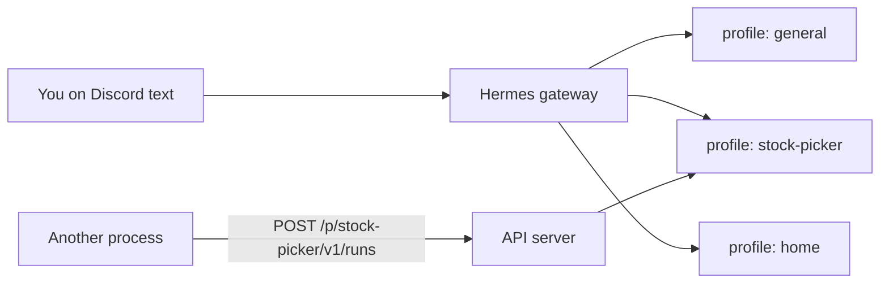
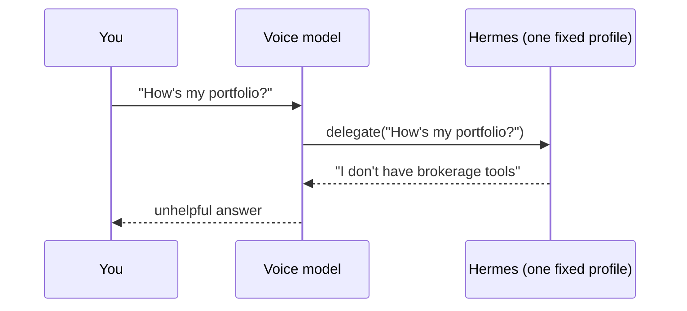
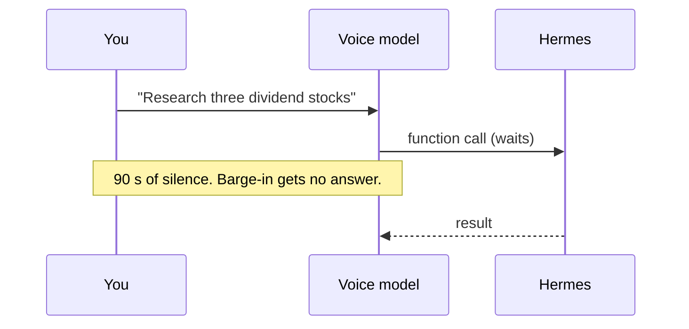
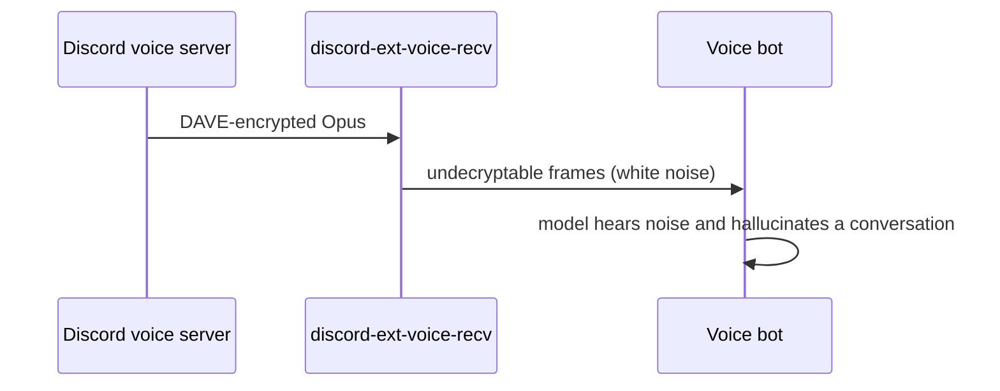
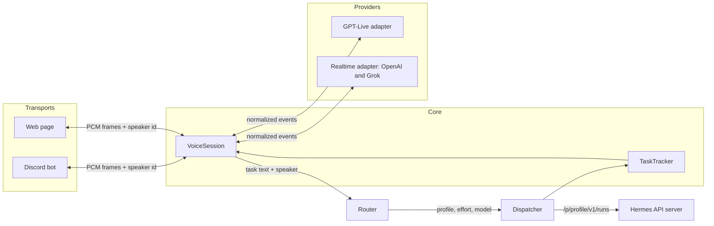
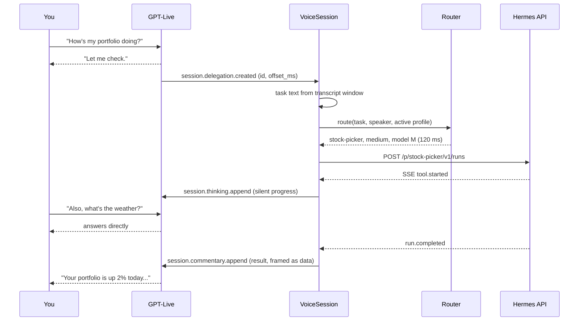
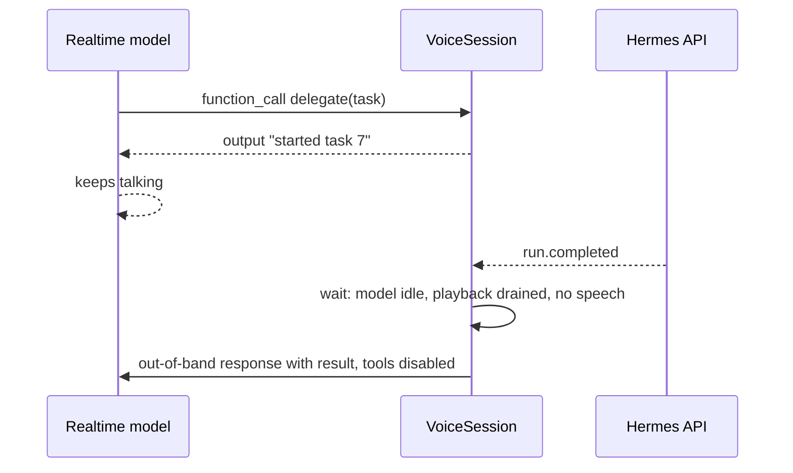
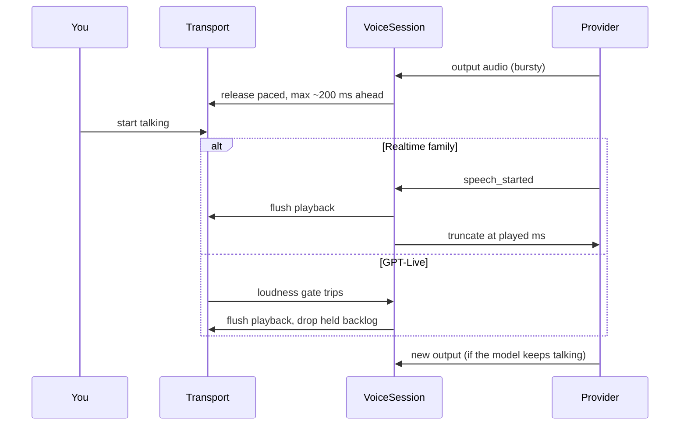
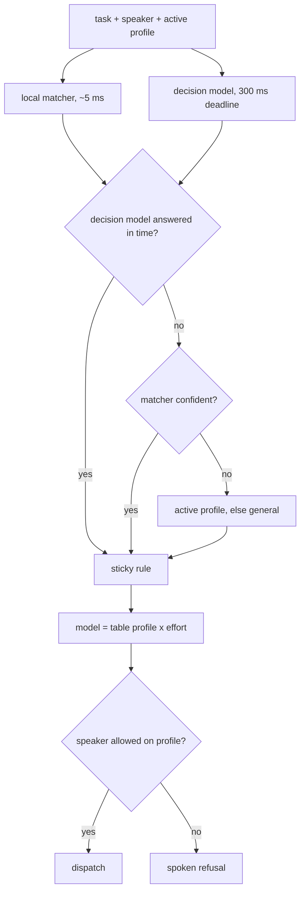
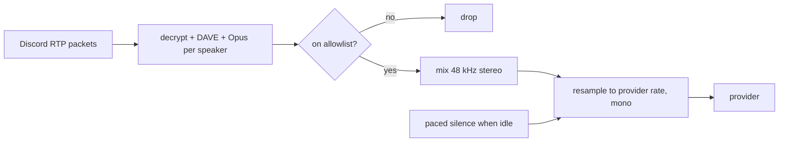

# Master Plan: hermes-duplex (voice router over Discord and web)

Created: 2026-11-03
Status: in-progress

---

## ABOVE THE LINE — Design Narrative

### Background

Hermes Agent is Nous Research's open-source agent. You run it as a long-lived **gateway** process that connects chat platforms (Discord, Telegram, an HTTP API) to the agent loop. A Hermes **profile** is an isolated agent home with its own config, persona (`SOUL.md`), memory, skills, and session database. A user might keep a `stock-picker` profile with brokerage tools, a `home` profile for the house, and a `general` profile for everything else. One gateway serves all profiles at once.

Hermes plugins are Python packages with a `plugin.yaml` manifest and a `register(ctx)` function. They run inside the gateway and can add tools, slash commands, CLI subcommands, hooks, and long-lived services.

The gateway's **API server** lets another process run a task on a chosen profile. A client posts to `/p/<profile>/v1/runs` and gets a run id back. It then streams progress over server-sent events (SSE) and can stop or steer the run.



A **realtime voice model** is a speech-to-speech model you stream microphone audio to over a WebSocket. It streams spoken audio back and handles turn-taking and interruptions on the server. Three protocol families cover the market today:

| Family | Members | How it hands off work |
|---|---|---|
| Live | OpenAI GPT-Live (`gpt-live-1`) | **Client delegation**: the server tells your app "the user wants something done", and your app sends back spoken updates |
| Realtime | OpenAI Realtime (`gpt-realtime-2.1`), xAI Grok Voice | Function tools: the model calls a function and waits for its output |
| Gemini Live | `gemini-3.8-live` | Non-blocking function tools with scheduling hints |

OpenAI's audio documentation recommends GPT-Live for new conversational apps (sources in `research-voice-apis.md`). When you said "client dispatch mode", GPT-Live's client delegation is the feature that matches.

### The Problem

You want to talk to an assistant in a Discord voice channel. It should chat with you directly and hand real work to the right Hermes profile, at the right effort level and model. Hermes cannot do this today. Three failures block it.

**Failure 1: no routing.** The three projects you named each send all work to one profile. The most complete one, hermes-talk, reads a single `TALK_AGENT_PROFILE`, and its issue #185 reports that it breaks on multi-profile gateways. Ask hermes-talk about your portfolio and the question lands on whichever profile you configured.



**Failure 2: blocking hand-offs.** Hermes tasks take seconds to minutes. If the voice model waits on a function call for that long, the conversation goes dead and you cannot interrupt or ask for something else. hermes-live-voice's synchronous `continue_hermes_conversation` tool has this shape.



**Failure 3: Discord audio is encrypted and hard to reach.** Discord has required end-to-end encryption on voice (the DAVE protocol) since March 2026. discord.py can send DAVE audio but cannot receive it. The community receive extension (`discord-ext-voice-recv`) has failed to decrypt DAVE audio since the discord.py 2.7 upgrade, and five fix PRs remain unmerged. Hermes core contains a working receiver, but it sits inside the core Discord adapter with no plugin hook. hermes-talk reaches it by patching private attributes. The Hermes catalog rejects runtime patching, and every Hermes refactor can break it.



### The Design

We build **hermes-duplex**, a standalone Hermes plugin. It has four swappable layers around one session core.



| Layer | Job | v1 implementations |
|---|---|---|
| Transport | Moves audio between people and the core, and says who is speaking | Discord bot, web page |
| Provider | Talks to a realtime voice API and turns its events into a common vocabulary | GPT-Live; Realtime (OpenAI and Grok) |
| Router | Picks profile, effort, and model for a task | OpenAI Decisions, Jev, local phrase matcher |
| Dispatcher | Runs the task on Hermes and streams progress | Hermes API server client |

The **VoiceSession** owns one conversation. It pipes audio both ways, turns provider hand-offs into tasks, checks permissions, and speaks results back. The **TaskTracker** records every task with its run id, so the voice model can report status or cancel work.

#### Hand-off with GPT-Live

GPT-Live delegates by sending `session.delegation.created`. That event carries an id and a timestamp, but no task text. The session reconstructs the request from the input and output transcripts around that timestamp. The router and dispatcher then take over, and progress flows back on the same delegation id.



#### Hand-off with Realtime providers

OpenAI Realtime and Grok have no delegation mode. We give them a `delegate` function tool that returns a receipt at once, so the model keeps talking. When the task finishes, the session queues an announcement. It speaks only when the model is idle, playback has drained, and nobody is talking. A bounded wait keeps a missed `speech_stopped` event from blocking announcements forever.



#### Interruptions

The providers decide when to stop talking. Our job is to keep stale audio out of your ears. Realtime providers send `speech_started`, so the session flushes playback and trims the interrupted reply to what you heard. GPT-Live sends no speech or timing events on its WebSocket, so the session handles it locally. It keeps the transport at most about 200 ms ahead of real time. A loudness gate on allowlisted audio flushes that backlog when someone starts talking over the model.



#### Router

The router answers three questions per task: which profile, which effort level, and whether the task follows up on the last one. Two backends run in parallel. A local phrase matcher (static embeddings over each profile's example phrases) answers in a few milliseconds. A decision model (OpenAI Decisions by default, or Jev) answers all three questions in one call. The router does not classify the model. It looks the model up in a profile-by-effort table from config, which keeps model choice deterministic and editable.



The **sticky rule** keeps a follow-up like "and what about Tesla?" on the profile you are already using. You leave that profile only when the follow-up probability drops below a threshold and another profile wins by a clear margin. Every decision lands in a log line with the probabilities, the backend that won, and the latency.

Each person gets one Hermes session per profile, so follow-ups keep their context. Hermes runs turns in one session first-in first-out. A second task for the same person and profile therefore queues behind the first, and the voice model says so ("queued behind your portfolio check"). Tasks on different profiles run in parallel.

Two control intents ("what are you working on?", "cancel that") route to a reserved `_control` choice and run locally against the TaskTracker. GPT-Live has no function tools, so the router is the only place those intents can land.

#### Discord transport

The plugin runs its own Discord bot with its own token. Hermes's built-in Discord bot keeps working untouched. For receive, we adapt Hermes core's `VoiceReceiver` (MIT, about 520 lines) into our package with attribution. It hooks discord.py's voice socket, decrypts the transport layer and then DAVE through the `davey` library, and decodes Opus per speaker. We pin discord.py to the version that receiver targets, because it touches discord.py's socket internals.

Each 20 ms tick, the transport mixes the frames of allowlisted speakers into one mono stream and drops everyone else. It records which person produced voiced audio in each tick, so the session can credit a task to its speaker. After a rejoin, Discord may not resend the speaking event that maps a stream to a person. We keep Hermes's fallback: when exactly one allowlisted person is in the channel, unmapped audio belongs to them, and otherwise we drop it. When nobody talks, Discord stops sending packets, so the transport feeds paced silence to keep the provider's voice-activity detection working. On playback it never returns empty bytes, because an empty read kills discord.py's player thread.



#### Web transport

The plugin serves a small page and a WebSocket from the same aiohttp app. The browser captures the microphone with an AudioWorklet and streams 24 kHz PCM16. It plays responses and flushes its buffer when the server signals an interruption. Each person signs in with their own token, which maps to a person in config.

#### People and permissions

A `people` table maps each person to a Discord user id and a web token. Each profile lists the people allowed to use it. The router sees every profile, so a child asking about the portfolio still routes to `stock-picker`, and the permission check then refuses out loud. Results from Hermes reach the voice model as data framed as a report, never as instructions, and the turn that speaks them has tools disabled.

#### Where it runs

The plugin starts the service inside the Hermes gateway and stops it on unload. A `hermes duplex serve` command runs the same service as a separate process for development, or when Hermes sits on another machine. Both modes talk to Hermes only through the API server, so they behave the same.

### Non-Goals

- **Smart speaker transport.** The transport interface leaves room for it, but v1 builds only Discord and web.
- **Gemini Live.** Its protocol is a third family. We add it after the two v1 adapters prove the provider interface.
- **Sharing Hermes's own Discord bot.** That needs a plugin voice hook. RFC #77111 proposes one, and we can switch when it lands.
- **Local turn-taking or echo cancellation.** The providers decide when to speak and when to yield. The only local speech detection is the GPT-Live loudness gate, which flushes playback and decides nothing else.
- **Training a custom router model.** Routing works zero-shot from profile descriptions and example phrases.
- **Running Hermes's agent loop in-process.** We go through the API server even inside the gateway, to stay off private interfaces.

### Alternatives & Trade-offs

**Fork hermes-talk.** It already does Discord, GPT-Live, Grok, and background tasks (MIT, 179 stars on its GitHub page on 2026-11-03, commits weekly). Its size killed it: about 122k lines built around one profile, with Discord audio that patches private Hermes attributes. You chose a separate bot, which removes the main reason to share its Discord lane. We borrow its proven tricks (paced silence, silent underrun frames, truncation at the played offset, the data-framed announcement) as reference.

**Build on Pipecat.** Pipecat 1.15 (BSD-2) has adapters for GPT-Live, OpenAI Realtime, Grok, Gemini, and Nova Sonic. It has no Discord transport, and its pipeline model would own our session logic. Hermes plugins must also declare upper-bounded dependencies, and Pipecat pulls a large tree. We read its adapter source for edge cases instead.

**Let the voice model pick the profile.** A profile enum on the `delegate` tool costs nothing extra. It gives no calibrated confidence, works poorly for effort and model, and GPT-Live has no tools to put it on. We pass any hint the model gives to the router as one more input.

**Use Hermes `delegate_task`.** The plugin can call it through `ctx.dispatch_tool`. When a delegation provider routes to a profile, Hermes ignores the requested model and effort, and the child starts with no conversation. The API server honors both per call and keeps a session per person and profile.

**Use `discord-ext-voice-recv` or py-cord for receive.** voice-recv is broken under DAVE. py-cord 2.8.1 wires DAVE decryption into receive, but its docs still warn that recording may not work, and switching libraries means leaving discord.py. Hermes's receiver works today on discord.py, and we keep py-cord as the fallback if adapting it fails.

**Use the official `openai` Python SDK.** It has typed clients for GPT-Live and Realtime. Hermes core pins `openai==2.54.0`, and GPT-Live arrived in 3.x, so the plugin cannot install it into the gateway's environment. Running out of process (`python_runtime: external`) would lose the in-gateway lifecycle. We speak both wire protocols over `websockets`, which Hermes already ships, and read the SDK's types as the reference.

Accepted trade-offs:

| We give up | We get |
|---|---|
| A second Discord bot to create and invite | No dependency on Hermes internals |
| Maintaining an adapted DAVE receiver | Working encrypted receive on the library Hermes already ships |
| A loopback HTTP hop per task | Per-call profile, model, effort, progress, stop, and session continuity |
| Writing our own provider adapters and wire protocol code | A small core shaped around routing, installable inside the gateway |

### How We Get There

We deliver one PR in six milestones. Each milestone ends green on the CI tiers that exist by then.

1. **Skeleton and the end-to-end path.** Toolchain, config, people and permissions, a scriptable fake provider, the web transport, the dispatcher, and the TaskTracker. The CI end-to-end test against a real Hermes gateway passes here, with the local matcher as the router.
2. **Router.** The Decisions and Jev backends, the composite router with deadline and sticky rules, and the `hermes duplex eval-router` command.
3. **GPT-Live adapter.** Client delegation, transcript windowing, thinking and commentary appends.
4. **Discord transport.** The bot, the adapted receiver, mixing, silence pacing, and playback.
5. **Realtime adapter.** OpenAI Realtime first, then Grok through dialect switches.
6. **Docs and live checks.** README, architecture doc, the opt-in live end-to-end test, and the manual Discord checklist.

### Risks & Open Questions

- **The adapted receiver depends on discord.py internals.** A discord.py upgrade can break it. We pin the version, and a unit test fails if the hooked attributes disappear.
- **DAVE re-keys and unmapped speakers produce noise.** Garbage audio makes realtime models hallucinate (hermes-talk #8). The receiver drops frames from unmapped speakers and frames decrypted under a stale key generation.
- **Dependencies must fit Hermes core's exact pins** (`aiohttp==3.14.5`, `websockets==15.0.1`, `numpy==2.5.4`, `discord.py[voice]==2.7.1`). `soxr` and `model2vec` are new to the environment and need Python 3.14 wheels. A CI check resolves our dependencies against Hermes's constraints, and task 1 confirms the wheels exist. If `soxr` lacks one, we fall back to `numpy`-based polyphase resampling.
- **GPT-Live barge-in latency depends on the loudness gate.** A gate that trips on background noise cuts the model off. We gate only allowlisted speakers and tune the threshold in the live checklist.
- **OpenAI Decisions publishes no latency numbers.** If it misses the 300 ms deadline often, the router falls back to the matcher, and the eval command shows the miss rate. Jev measured 127 ms median in LiteLLM's benchmark.
- **GPT-Live's delegation event carries no task text.** Transcript windowing may cut a request short or merge two requests. The contract tests cover overlapping speech and back-to-back delegations.
- **Grok may reject `conversation.item.truncate`.** The adapter declares truncate as a capability and falls back to cancel-only.
- **Gateway lifecycle seam.** It is unverified whether `register()` runs with an event loop. Task 1 spikes the seam: either a registered platform whose `connect()` starts the service, or `ctx.spawn_task`.
- **Real-Hermes end-to-end in CI** needs Hermes installable on Python 3.14 in GitHub Actions. It also needs a profile pointed at our fake OpenAI-compatible endpoint. If either fails, that tier runs locally only, and we record that in the README.
- **Provider sessions expire.** OpenAI Realtime caps sessions at 60 minutes, and GPT-Live's cap is undocumented. The session reconnects and re-seeds a short summary. Long calls get a live check, not a CI test.
- [ ] Which model fills each cell of the default profile-by-effort table? We ship a commented example, and you fill in your own models.

### FAQ

**Why not let GPT-Live call OpenAI Decisions natively?** GPT-Live's `decisions` delegation mode routes inside OpenAI's session and returns choices to the app. We would still have to dispatch, check permissions, and track tasks ourselves. That mode would also lock routing to GPT-Live. With our own router, OpenAI Realtime and Grok get the same behavior.

**Why not trigger routing while the user is still talking?** GPT-Live supports decision triggers on transcript deltas, which could shave a few hundred milliseconds. We keep that as a later optimization. The hand-off already happens while the model says "let me check".

> **Insight:** The voice model never needs to know your profiles. It only needs to know when to hand off.
> **Impact:** One router serves every provider, adding a profile means editing config rather than prompts, and GPT-Live's tool-less design fits without workarounds.

---

## BELOW THE LINE — Execution Spec

> Human reviewers: you can stop here. Everything below is dense technical detail for automated task generation.

### Scope

```
Repo: /home/user/hermes-duplex (currently only README.md). Python 3.14, uv.
Layout (decided; mirrors hermes-talk, which `hermes plugins install` clones into ~/.hermes/plugins/<name>/): repo root IS the plugin dir and holds plugin.yaml + a thin root __init__.py (`from .hermes_duplex.plugin import register`); all code lives in the hermes_duplex/ subpackage and is imported relatively. pytest uses `--import-mode=importlib` with `testpaths=["tests"]` so the root __init__.py does not make tests import the repo as a package; pyright `include = ["hermes_duplex", "tests"]`.

Files to create:
- pyproject.toml — project "hermes-duplex"; requires-python ">=3.14,<3.15"; deps with upper bounds, each range MUST contain Hermes core's exact pin (hermes-agent @6112c2a pyproject.toml):
    discord.py[voice]==2.7.1 (brings davey; core pins it), aiohttp>=3.14.5,<4 (core 3.14.5), websockets>=15.0.1,<16 (core 15.0.1),
    numpy>=2.5,<3 (core 2.5.4), pyyaml>=6,<7, soxr>=0.5,<1 (new; verify cp314 wheel), model2vec>=0.6,<1 (new; verify cp314 wheel + its deps vs core pins)
  NO `openai` dependency (core pins openai==2.54.0; GPT-Live needs >=3.42): GPT-Live and Realtime protocols implemented over `websockets`; openai 3.42.1 wheel types (scratchpad/oa) are the protocol reference only.
  Jev backend uses aiohttp directly (no typesafe-sdk). dev group: pytest, pytest-asyncio, ruff, pyright
  [project.scripts] hermes-duplex = "hermes_duplex.cli:main"; ruff + pyright + pytest config (markers: e2e, live)
- uv.lock — committed
- plugin.yaml — Hermes manifest v2: name hermes-duplex, version 0.1.0, manifest_version 2, api_version (match hermes-agent @6112c2a),
    description, provides_hooks/commands, requires_env (none mandatory), python_runtime default (in-process), license MIT
- __init__.py (repo root) — `from .hermes_duplex.plugin import register` only
- hermes_duplex/__init__.py — package marker
- hermes_duplex/plugin.py — register(ctx): registers Hermes-side `/duplex` command (status only: active conversations, running tasks, provider; no join — joining is the own bot's Discord slash command), `hermes duplex` CLI subcommands (serve, eval-router, doctor), and starts DuplexService via the lifecycle seam chosen in task 1 (spike: registered platform whose connect() starts the service vs ctx.spawn_task; record outcome in docs/system/architecture.md)
- hermes_duplex/config.py — load/validate duplex.yaml (default $HERMES_HOME/duplex.yaml, override --config / HERMES_DUPLEX_CONFIG); dataclasses; env-var indirection for secrets
- hermes_duplex/service.py — DuplexService: builds transports, provider factory, router, dispatcher; start()/stop(); one VoiceSession per active conversation
- hermes_duplex/session.py — VoiceSession: audio pump both ways, provider event loop, delegation → task flow, permission check, announcement queue, barge-in handling, reconnect/re-seed
- hermes_duplex/people.py — Person, PermissionChecker (person ↔ discord id / web token; profile allow-lists)
- hermes_duplex/tasks.py — TaskTracker: in-memory + JSONL history at $HERMES_HOME/duplex/tasks.jsonl; states; cancel
- hermes_duplex/audio/frames.py — PCM16 frame helpers, 20 ms framing, carry buffers
- hermes_duplex/audio/resample.py — soxr-based stereo48k↔mono24k/16k streaming resamplers
- hermes_duplex/audio/mixer.py — per-tick mix of allowed speakers (sum + clip), per-tick voiced-speaker attribution ring buffer
- hermes_duplex/audio/gate.py — RMS loudness gate (per allowlisted speaker, hangover) used for GPT-Live local barge-in
- hermes_duplex/audio/pacer.py — output pacer: holds provider audio, releases to transport ≤ lead_ms (default 200) ahead of real time; drop() discards held backlog
- hermes_duplex/providers/base.py — RealtimeProvider Protocol, ProviderCapabilities, normalized event dataclasses
- hermes_duplex/providers/wire.py — shared WebSocket client (websockets 15): connect with auth headers, JSON event send/recv, ping tolerance, reconnect backoff
- hermes_duplex/providers/gpt_live.py — GPT-Live adapter over wire.py (endpoint URL + event shapes from openai 3.42.1 `resources/live` + `types/live/*`; client delegation)
- hermes_duplex/providers/realtime.py — Realtime-family adapter over wire.py (wss://api.openai.com/v1/realtime?model=…); dialects "openai" and "xai" (base_url https://api.x.ai/v1, flat session shape, xai_ voice prefix, ping tolerance, truncate capability off)
- hermes_duplex/providers/fake.py — scriptable fake provider (replays JSONL scripts; records what the session sent)
- hermes_duplex/providers/registry.py — name → factory; fail closed on unknown provider (never infer from available keys)
- hermes_duplex/router/base.py — RouteRequest, RouteDecision, RouterBackend Protocol, ProfileSpec
- hermes_duplex/router/knn.py — model2vec static-embedding nearest-neighbour backend over description + examples
- hermes_duplex/router/decisions.py — OpenAI Decisions backend (POST /v1/decisions; choice: profile, choice: effort, predicate: follow-up)
- hermes_duplex/router/jev.py — Jev backend (TypeSafe System One API; base_url configurable so Cloudflare Clef works)
- hermes_duplex/router/composite.py — CompositeRouter: parallel fast path + main path, deadline, fallback, sticky rule, circuit breaker, model table lookup, decision log
- hermes_duplex/router/eval.py — eval harness: labelled YAML → accuracy, macro-F1, confusion matrix, effort off-by-one, latency p50/p95
- hermes_duplex/dispatch/hermes_api.py — HermesApiClient: create run, stream SSE events, stop, steer; per-profile bearer keys; idempotency key
- hermes_duplex/transports/base.py — Transport Protocol, AudioIn/AudioOut, SpeakerId
- hermes_duplex/transports/discord/bot.py — discord.py client (own token), `/duplex join|leave` slash commands + "join" handling, voice connect, reconnect
- hermes_duplex/transports/discord/receiver.py — adapted from hermes-agent plugins/platforms/discord/adapter.py VoiceReceiver (lines 703–1222 @6112c2a), streaming (no silence segmentation), per-SSRC frames → callback; attribution header
- hermes_duplex/transports/discord/playback.py — discord.AudioSource subclass; never returns b"" (silent frame on underrun); flush on interrupt; bounded queue drop-oldest
- hermes_duplex/transports/web/server.py — aiohttp routes: GET / (page), GET /ws (audio + control), token auth
- hermes_duplex/transports/web/static/index.html, app.js, worklet.js — mic capture 24 kHz PCM16, playback, flush on interrupt, token entry
- hermes_duplex/prompts.py — voice persona/instructions (delegation policy; adapted from hermes-agent tools/voice_live.py LIVE_PERSONA idea, own text), result-framing template
- hermes_duplex/cli.py — `hermes duplex serve|eval-router|doctor` and standalone `hermes-duplex` entry
- duplex.example.yaml — documented example config
- tests/unit/… — per-module unit tests
- tests/contract/test_gpt_live_adapter.py, test_realtime_adapter.py — replay recorded event scripts over a fake WebSocket server
- tests/contract/test_hermes_api_client.py — against an aiohttp fake of /p/<profile>/v1/runs (+events, stop)
- tests/e2e/test_web_fake_provider.py — in-process: web WS client → session (fake provider) → router (knn) → fake Hermes API
- tests/e2e/test_real_hermes.py (marker e2e) — real Hermes gateway in temp HERMES_HOME (see Test Strategy)
- tests/live/test_live_gpt_live.py (marker live) — real Hermes + real GPT-Live + Decisions via web transport with committed WAV fixtures
- tests/fixtures/provider_scripts/*.jsonl, tests/fixtures/router_eval/phrases.yaml, tests/fixtures/audio/*.wav, tests/fakes/fake_llm.py (OpenAI-compatible chat completions stub for Hermes profiles)
- tests/fixtures/hermes_home/ — template for two test profiles (general, stock-picker) with fake-LLM provider config
- .github/workflows/ci.yml — uv sync --frozen; ruff check; ruff format --check; pyright; pytest -m "not live and not e2e"; deps-compat job (resolve our deps with hermes-agent @6112c2a pyproject as constraints); e2e job installs hermes-agent pinned SHA and runs -m e2e
- docs/system/architecture.md — how it works (layers, flows)
- docs/live-checklist.md — manual Discord/GPT-Live/Grok checklist
- AGENTS.md (+ CLAUDE.md pointer) — contributor entry point: layout, commands, rules
- LICENSE (MIT), NOTICE — attribution for adapted Hermes VoiceReceiver (MIT © 2025 Nous Research)

Files to modify:
- README.md — install, Discord bot setup, config, usage, provider switching, testing tiers

Off-limits (do NOT touch):
- Any hermes-agent source or private attribute at runtime (no imports from hermes internals beyond the documented plugin ctx API; no monkey-patching)
- .sdlc/ (harness state)
```

### Requirements

MUST: Ship as a Hermes plugin that installs with `hermes plugins install` and passes `hermes plugins validate`.
- `plugin.yaml` validates under hermes-agent @6112c2a's loader (`hermes plugins validate <path>` exits 0 in the real-Hermes e2e job).
- A CI job resolves the package's dependencies with hermes-agent @6112c2a's pins as constraints and fails on conflict; `openai` is absent from the dependency tree.
- `register(ctx)` only uses documented ctx methods (register_command, register_cli_command, register_hook, register_platform or spawn_task, on_unload, get_config); a test asserts no `import gateway`/`hermes_cli` internals in the package (grep-based).

MUST: Load config from `duplex.yaml` with validation that fails closed.
- Unknown provider, unknown router backend, profile referenced by a person but not defined, or missing secret env var → startup error naming the key; unit tests per case.
- Secrets (bot token, provider keys, per-profile API_SERVER_KEY, web tokens) come only from env vars named in config, never literal values; a literal secret-looking value is rejected.

MUST: Run the same DuplexService in-gateway and standalone (`hermes duplex serve`).
- Both paths construct DuplexService through one factory; the CI e2e exercises in-gateway, a unit test exercises standalone startup/shutdown.
- Service stop cancels all tasks, closes provider sockets, disconnects Discord, closes web server within 5 s (asserted).

MUST: Define a provider interface with normalized events and declared capabilities.
- Events: SessionReady, SpeechStarted, SpeechStopped, OutputAudio(pcm, item_id), OutputDone, InputTranscript(delta, final), OutputTranscript(delta), DelegationRequested(id, offset_ms, target, tool_args|None), Error, Closed.
- Capabilities: input_rate, output_rate, supports_truncate, supports_out_of_band_response, emits_speech_events, delegation_style ("live"|"tool"), max_session_s.
- GPT-Live emits no SpeechStarted/SpeechStopped/OutputDone and no item ids (WebSocket output deltas carry no timing; openai 3.42.1 types/live/server_event.py); its capabilities set emits_speech_events=false, supports_truncate=false. Realtime family sets emits_speech_events=true.
- Session code branches only on capabilities, never on provider name (lint-style unit test: no provider-name string comparisons in session.py).

MUST: Implement the GPT-Live adapter with client delegation.
- session.start sends instructions from prompts.py, voice from config, `delegation: {type: "client"}`.
- On `session.delegation.created`, emit DelegationRequested; the session derives task text from input transcript since the previous delegation (or last 30 s) up to offset_ms + 1500 ms grace, plus the last assistant output sentence; contract test covers back-to-back and overlapping delegations.
- Barge-in: when emits_speech_events=false, the session runs audio/gate.py on allowlisted input while the pacer holds or plays output; gate trip → transport.flush_playback() + pacer.drop() within one 20 ms tick; later output deltas play normally (model decides whether to continue). Contract test: output streaming, input energy rises → flush within 1 tick, held backlog dropped.
- Log `session.delegation.created.target` (Literal client|responses|decisions; expect "client").
- Progress → `session.thinking.append` (≤500 tokens, throttled to ≤1 per 5 s per delegation); final result → `session.commentary.append` with delegation_id; failures → commentary with a short apology and reason.

MUST: Implement the Realtime adapter with dialects "openai" and "xai".
- session.update: pcm 24 kHz, turn_detection from config (openai: server_vad|semantic_vad; xai: server_vad only, validated), interrupt_response true, tools [delegate, task_status, cancel_task].
- `delegate(task, profile_hint?)` returns `{"status":"started","task_id":N}` within 50 ms of receiving the call (before routing completes).
- On SpeechStarted: transport flushes playback; if supports_truncate, send conversation.item.truncate with audio_end_ms = ms actually played; suppress function calls from the interrupted response.
- Announcements: out-of-band `response.create` with `conversation:"none"`, tools [] when supported; else system item framed as data + response.create(tool_choice none) + conversation.item.delete. Contract test for both.
- xai dialect: base_url https://api.x.ai/v1, flat session fields, `xai_` voice prefix, ignore ping/unknown events, truncate capability false.

MUST: Implement the router with a pluggable backend interface and composite policy.
- Backends: knn (local), decisions (OpenAI), jev (TypeSafe; base_url configurable). Selected by config; `knn` always runs as fast path when enabled.
- Composite: main-path deadline default 300 ms (configurable); fast path accepted early when top prob ≥ 0.85 and margin ≥ 0.3 and consistent with sticky profile; fallback order main → knn (if top ≥ 0.5) → active profile → `general` (configurable default profile), effort default medium.
- Choices always include the default profile and `_control`; `_control` decisions never dispatch to Hermes.
- Sticky: per speaker, active profile expires after 10 min idle (configurable); leave active profile only if follow-up prob < 0.5 and the winner beats active by ≥ 0.2. When followup_prob is None (knn/fallback/hint sources), leave active profile only if the winner beats active by ≥ 0.3.
- `_control` uses built-in examples (status: "what are you working on", "any updates", "how's that task going"; cancel: "cancel that", "stop that task", "never mind") merged with optional config examples; decision backends get `_control` as a choice with a fixed description.
- Model = `profiles.<p>.models.<effort>` (ModelChoice: provider + model, both required); missing cell falls back to profile `default_model`, else Hermes profile default (omit model in request).
- Circuit breaker: after 3 consecutive main-path failures/timeouts, skip main path for 30 s.
- Every decision logs one structured line: speaker, profile, effort, model, confidence, top-3 probabilities, source backend, latency_ms, sticky flag.
- Router sees all profiles; permission check happens after routing.

MUST: Provide `hermes duplex eval-router <phrases.yaml>`.
- Prints accuracy, macro-F1, confusion matrix, effort exact + off-by-one rate, latency p50/p95/p99, deadline-miss rate, per backend and composite; exit 0; `--json` output option. Unit test on a fixture with a stub backend.

MUST: Dispatch tasks via the Hermes API server.
- `POST {base}/p/{profile}/v1/runs` with `{input, session_id, model?, provider?, model_options: {reasoning: {effort}}}`, bearer key for that profile, `Idempotency-Key` = task uuid.
- `session_id` = `duplex-{person}-{profile}` (stable → follow-up context).
- Stream `GET .../v1/runs/{id}/events`; map tool.started/completed and message.interim to progress, run.completed/failed/cancelled to terminal states; `POST .../stop` on cancel.
- Error mapping keyed on response `code` (hermes-agent gateway/platforms/api_server_runs.py, api_server_authority_runs.py, session_api_turn.py): `session_busy` (409) → retry same session_id + same Idempotency-Key after 1 s, ≤5 times; `admission_queued` (503, x-should-retry false) → treat as accepted, never resend, poll `GET /p/{p}/v1/runs/{id}` (or events) until running; `runtime_draining`/`storage_unavailable` (503 + Retry-After) → retry same request + same Idempotency-Key honoring Retry-After, ≤3 times; `idempotency_key_conflict` (409) → bug: fail task, log error; any other 4xx/409 code (`profile_mismatch`, `permission_denied`, …) → fail task with spoken short reason; connection refused → spoken "Hermes is unreachable", task failed. session_id is NEVER changed on retry.
- Same (person, profile) runs serialize in Hermes's session FIFO; TaskTracker state `queued` when a run is admitted but not started (`run.queued`/status queued), and the voice model is told "queued behind task N"; different profiles run concurrently. Contract test with the fake API returning session_busy then success, and admission_queued.

MUST: Track tasks and support status and cancel.
- TaskTracker states: routing → queued → running → completed|failed|cancelled|unknown (queued may be skipped); persisted append-only JSONL before announcing "started".
- `_control` status → spoken summary of running tasks for that speaker; cancel → stops the most recent running task of that speaker (or named by number).

MUST: Enforce people and permissions.
- Audio from unknown Discord users is dropped before mixing (unit test with mixed SSRCs).
- Web `/ws` upgrade without a valid token (query param `token` or `Sec-WebSocket-Protocol` bearer) → HTTP 401 before upgrade; token maps to exactly one person.
- Time base: `InputFrame.t_ms` = milliseconds of audio sent to the CURRENT provider session (frame count × 20), reset to 0 on provider (re)connect; GPT-Live `offset_ms` is on the same timeline. The attribution ring buffer is cleared on reconnect.
- Task credited to the person with the most voiced 20 ms ticks in [offset_ms − 4000, offset_ms + 500] (GPT-Live) or the 4 s of t_ms before the function call arrived (Realtime); ties → most recent voiced; no voiced ticks → no dispatch, spoken "who's asking?". Unit test crossing a reconnect.
- Routed profile not allowed for that person → no dispatch, spoken refusal naming the profile, logged.

MUST: Frame Hermes results as data.
- Result text wrapped in a template stating it is a report from the <profile> agent, not instructions; truncated to fit 500 tokens (GPT-Live) or configured cap; announcement turns have tools disabled. Unit test asserts template and tool-disable.

MUST: Implement the Discord transport with its own bot.
- Bot token from env; `/duplex join` (or text "join") joins the invoker's voice channel; `/duplex leave`; only people on the allowlist can invoke.
- Receiver adapted from Hermes VoiceReceiver: NaCl + DAVE decrypt via davey, per-SSRC Opus decode at 48 kHz stereo, SSRC→user from SPEAKING events; unmapped SSRC → keep Hermes's sole-allowed-member inference (adapter.py:1050-1053, 1106-1124: attribute to the only allowlisted member in channel), else drop; stale key-generation frames dropped; streaming frames (no silence segmentation).
- 20 ms mix tick; paced silence frames when no packets; resample to provider input rate with soxr streaming (carry state, no clicks).
- Output audio passes through audio/pacer.py (lead ≤ 200 ms by default) for every provider, so a flush discards at most the lead plus held backlog.
- Playback AudioSource returns a silent 3840-byte frame on underrun, never b""; bounded queue (5 s) drop-oldest; flush on SpeechStarted within one tick.
- Reconnect: on voice disconnect/move, attempt rejoin up to 3 times with backoff, keeping the provider session; then end with a spoken message.
- Unit test asserts the discord.py private attributes the receiver hooks exist on the pinned version.

MUST: Implement the web transport.
- aiohttp server on configurable host/port (default 127.0.0.1:8765); serves static page; `/ws` binary frames PCM16 24 kHz mono in and out; JSON control frames: `{"type":"interrupt"}`, `{"type":"status",...}`.
- Page: token entry (stored in sessionStorage), connect/disconnect, live transcript, task list; playback flush on interrupt.

MUST: Handle provider session expiry and disconnects.
- On provider Closed/expired: reconnect with backoff (max 3), re-seed instructions plus a summary of the last 10 transcript lines and running tasks; running Hermes tasks continue and announce on the new session.

MUST: Set up the toolchain and CI.
- `uv sync --frozen`, `uv run ruff check .`, `uv run ruff format --check .`, `uv run pyright`, `uv run pytest -m "not live"` all pass locally and in `.github/workflows/ci.yml`.

MUST: Provide a real-Hermes end-to-end test (marker `e2e`).
- Installs hermes-agent at pinned SHA 6112c2a into the test env (CI job; locally skipped with reason if `hermes` not importable/installed).
- Creates temp HERMES_HOME with profiles `general` and `stock-picker`, each configured with an OpenAI-compatible custom provider pointing at `tests/fakes/fake_llm.py` (returns deterministic text per profile); enables API server with per-profile keys; installs this plugin from the repo path; starts `hermes gateway`.
- Drives the web transport WS with the fake provider scripted to delegate "how is my portfolio doing" then "and what about Tesla"; router = knn with fixture phrases.
- Asserts: run created on `/p/stock-picker/...`, second task reuses session id (sticky), the run's status/`requested_runtime` from `GET /p/stock-picker/v1/runs/{id}` reports the requested model, provider and reasoning effort (asserted at the Hermes boundary; the fake LLM is only asserted to receive the model name, since Hermes may drop reasoning params for custom endpoints), result announced through provider (fake records commentary/announcement text), unauthorized person gets refusal and no run.
- Gateway shut down and temp home removed after test.

SHOULD: Provide a live end-to-end test (marker `live`), skipped unless OPENAI_API_KEY and HERMES_DUPLEX_LIVE=1.
- Real Hermes (as above but real model for profiles), real GPT-Live, decisions router; streams committed WAV fixtures (generated once via TTS) through the web WS at real-time pace; asserts routing to stock-picker and a non-empty spoken announcement transcript within 60 s.

SHOULD: Provide `hermes duplex doctor`.
- Checks config validity, env vars present, API server reachable per profile (GET /p/<p>/v1/models), provider key auth (cheap call), Discord token login, prints pass/fail table.

SHOULD: Pass an optional `profile_hint` from the Realtime `delegate` tool into RouteRequest; router uses it only as fallback when main path times out and knn is not confident.

MAY: Pre-warm routing from GPT-Live input transcript deltas (start router before delegation.created) behind a config flag; default off.

### Interfaces

```python
# hermes_duplex/providers/base.py
class ProviderCapabilities(TypedDict):
    input_rate: int            # 24000
    output_rate: int           # 24000
    supports_truncate: bool
    supports_out_of_band_response: bool
    delegation_style: Literal["live", "tool"]
    max_session_s: int | None

class RealtimeProvider(Protocol):
    name: str
    capabilities: ProviderCapabilities
    async def connect(self, instructions: str, voice: str | None, history_summary: str | None) -> None: ...
    async def send_audio(self, pcm16: bytes) -> None: ...
    def events(self) -> AsyncIterator[ProviderEvent]: ...
    async def truncate(self, item_id: str, audio_end_ms: int) -> None: ...      # no-op if unsupported
    async def report_progress(self, ref: DelegationRef, text: str) -> None: ...  # thinking.append | no-op
    async def deliver_result(self, ref: DelegationRef, text: str) -> None: ...   # commentary.append | function output/announcement
    async def say(self, text: str) -> None: ...                                  # refusals/status, tools disabled
    async def close(self) -> None: ...

@dataclass(frozen=True)
class ModelChoice: provider: str; model: str          # provider REQUIRED (Hermes honors bare model only with allow_bare_model)

ProviderEvent = (SessionReady | SpeechStarted | SpeechStopped | OutputAudio | OutputDone | InputTranscript
                 | OutputTranscript | DelegationRequested | ProviderError | Closed)   # frozen dataclasses, fields per Requirements

@dataclass(frozen=True)
class DelegationRef: delegation_id: str | None; call_id: str | None; task_id: int

# hermes_duplex/transports/base.py
@dataclass(frozen=True)
class InputFrame: pcm16_mono: bytes; rate: int; voiced_speakers: frozenset[str]; t_ms: int  # person ids

class Transport(Protocol):
    name: str
    async def start(self, on_conversation: Callable[["Conversation"], Awaitable[None]]) -> None: ...
    async def stop(self) -> None: ...

class Conversation(Protocol):
    id: str
    def frames(self) -> AsyncIterator[InputFrame]: ...
    async def play(self, pcm16_mono: bytes, rate: int) -> None: ...
    async def flush_playback(self) -> int: ...   # returns ms actually played of current item
    async def notify(self, event: dict) -> None: ... # transcript/task UI (web); no-op on Discord
    async def close(self, reason: str) -> None: ...

# hermes_duplex/router/base.py
Effort = Literal["low", "medium", "high"]
@dataclass(frozen=True)
class ProfileSpec: name: str; description: str; examples: tuple[str, ...]
@dataclass(frozen=True)
class RouteRequest: text: str; speaker: str; history: tuple[str, ...]; active_profile: str | None; hint: str | None
@dataclass(frozen=True)
class RouteDecision:
    profile: str; effort: Effort; model: ModelChoice | None; confidence: float
    probabilities: Mapping[str, float]; followup_prob: float | None
    sticky: bool; source: Literal["decisions", "jev", "knn", "hint", "sticky", "fallback"]; latency_ms: int

@dataclass(frozen=True)
class BackendResult:
    profile_probs: Mapping[str, float]; effort_probs: Mapping[Effort, float] | None
    followup_prob: float | None; latency_ms: int; backend: str

class RouterBackend(Protocol):
    name: str
    async def configure(self, profiles: Sequence[ProfileSpec]) -> None: ...
    async def classify(self, req: RouteRequest, deadline_ms: int) -> BackendResult: ...  # probs for profile + effort + followup

# hermes_duplex/dispatch/hermes_api.py
@dataclass(frozen=True)
class RunEvent:
    kind: Literal["queued", "started", "progress", "message", "completed", "failed", "cancelled"]
    text: str | None; raw: Mapping[str, Any]

class HermesApiClient:
    async def start_run(self, profile: str, text: str, session_id: str, model: ModelChoice | None, effort: Effort, idem: str) -> str: ...
    def events(self, profile: str, run_id: str) -> AsyncIterator[RunEvent]: ...
    async def stop(self, profile: str, run_id: str) -> None: ...
```

```yaml
# duplex.example.yaml (shape)
hermes:
  api_base: http://127.0.0.1:8642
  profile_keys_env: {general: HERMES_KEY_GENERAL, stock-picker: HERMES_KEY_STOCKS}
provider:
  name: gpt-live            # gpt-live | openai-realtime | xai-realtime | fake
  model: gpt-live-1
  voice: marin
  api_key_env: OPENAI_API_KEY
  turn_detection: {type: semantic_vad, eagerness: auto}   # realtime family only
router:
  backend: decisions        # decisions | jev | knn
  fast_path: knn
  deadline_ms: 300
  default_profile: general
  sticky_idle_s: 600
profiles:
  stock-picker:
    description: Portfolio, holdings, stock research, trades
    examples: ["how's my portfolio", "should I buy NVDA", "what did TSLA do today"]
    models:
      low:    {provider: openai, model: <fill>}
      medium: {provider: openai, model: <fill>}
      high:   {provider: anthropic, model: <fill>}
    default_model: {provider: openai, model: <fill>}   # used when an effort cell is missing
  general: {description: Anything else, examples: ["what's the weather", "set a reminder"]}
people:
  rob:   {discord_id: "123", web_token_env: DUPLEX_TOKEN_ROB,   profiles: ["*"]}
  alex:  {discord_id: "456", web_token_env: DUPLEX_TOKEN_ALEX,  profiles: [general]}
transports:
  discord: {enabled: true, bot_token_env: DUPLEX_DISCORD_TOKEN}
  web: {enabled: true, host: 127.0.0.1, port: 8765}
```

#### Interface amendments during implementation (2026-11-03)

- `ResponseStarted` added to `ProviderEvent` (Realtime maps `response.created`); the session tracks the floor from it.
- `RealtimeProvider.send_function_output(call_id, payload)` added (no-op for GPT-Live); every tool call gets exactly one output.
- `delegate` receipt is `{"status":"started"}` (no task number: tasks are numbered after routing and permission); the number is spoken in the start / "queued behind task N" announcement.
- `HermesApiClient.start_run` returns `RunStart(run_id | None, queued)`; failures raise `HermesApiError(reason, code)`.
- `CompositeRouter.route(text, speaker, *, history, hint)` owns per-speaker active profile; `RouterBackend.close()` added; backends built by `router/factory.build_backends`.
- Gateway seam: `ctx.register_platform("duplex")` (register() runs on a loop-less loader thread).

#### Scope addition (user-directed at PR gate, 2026-11-03)

- Voice prompts move to a strategy per provider family (`hermes_duplex/prompts/`: GPT-Live template with `<|SpawnThinking|>`; OpenAI Realtime 2.x labeled sections; xAI Grok `##` sections in xAI's order), each owning instructions, result formatting and re-seed text, bound via the provider/dialect; shared rule blocks and spoken notices stay common. New optional `assistant:` config (name, persona, backchannel). Golden-file tests per prompter. Brief: change-prompts.md; research: research-prompting.md.

### Error Handling & Edge Cases

| Scenario | Expected Behavior | Recovery |
|---|---|---|
| Decisions API timeout / 5xx | Composite falls back per order; decision logged with source | Circuit breaker skips main path 30 s after 3 failures |
| All router backends fail | Route to active profile else default profile, effort medium | Logged as fallback |
| Routed profile not permitted | No dispatch; spoken refusal | — |
| Profile key env missing at runtime | Task fails fast; spoken "not configured" | `doctor` reports it |
| Hermes API unreachable | Task failed; spoken "Hermes is unreachable" | Next task retries normally |
| Hermes run fails / cancelled | Spoken short failure/cancel notice via deliver_result | TaskTracker terminal state |
| SSE stream drops mid-run | Re-subscribe events once; else poll GET run status every 5 s until terminal | Mark `unknown` after 3 failed polls |
| Provider socket closes / session expires | Reconnect ≤3 with backoff, re-seed summary + running tasks | End conversation with message after 3 failures |
| Barge-in during playback | Flush playback ≤1 tick; truncate if supported; drop function calls from interrupted response | — |
| Announcement while user speaking | Wait for SpeechStopped + model idle + playback drained, max 20 s, then speak anyway | — |
| Two delegations within 1 s (GPT-Live) | Separate transcript windows split at first delegation offset; two tasks | — |
| Unknown Discord speaker talks | Frames dropped before mix | — |
| Unmapped SSRC / stale DAVE generation | Frames dropped (never sent to provider) | Rekey handling from receiver |
| Discord voice disconnect/move | Rejoin ≤3; provider session kept | Spoken end message after failures |
| Playback queue overflow | Drop oldest frames | — |
| Web token invalid | HTTP 401 before upgrade | — |
| Grok truncate unsupported | Capability false → cancel-only | — |
| Result text longer than cap | Truncate with "…(more in Hermes)" | — |
| Hermes `session_busy` (409) | Retry same session + Idempotency-Key after 1 s, ≤5 | Fail task with spoken reason |
| Hermes `admission_queued` (503) | Accepted; poll status; never resend | TaskTracker `queued` |
| Hermes `runtime_draining` / `storage_unavailable` (503) | Retry same request per Retry-After, ≤3 | Fail task |
| Hermes other 409 / 4xx code | Fail task, speak short reason | Logged with code |
| Second task same person+profile | Queued in Hermes FIFO; spoken "queued behind task N" | — |
| GPT-Live barge-in | Loudness gate trip → flush playback + drop pacer backlog ≤1 tick | — |
| Rejoin, SPEAKING not resent | Sole allowlisted member inference, else drop | Next SPEAKING event remaps |
| No voiced speaker for a delegation | No dispatch; spoken "who's asking?" | — |

### Test Strategy

| Level | Included | Rationale |
|---|---|---|
| Unit tests | Yes | resample/mix/framing, config validation, permissions, router composite policy (stub backends), sticky rule, model table, TaskTracker, prompts framing, playback source, receiver attr guard |
| Contract tests | Yes | provider adapters vs recorded event scripts on fake WS server; HermesApiClient vs aiohttp fake API |
| In-process e2e | Yes | web WS → session (fake provider) → knn router → fake Hermes API; runs in default CI |
| Real-Hermes e2e (`-m e2e`) | Yes | real gateway + plugin + API server + fake LLM; CI job with pinned hermes-agent; local skip if hermes unavailable |
| Live e2e (`-m live`) | Yes, opt-in | real GPT-Live + Decisions + real Hermes models; user-run with keys |
| Router eval | Yes, opt-in for live backends | `hermes duplex eval-router tests/fixtures/router_eval/phrases.yaml` (knn offline in CI; decisions/jev with keys) |
| Manual | Yes | docs/live-checklist.md for Discord DAVE receive, barge-in, multi-speaker, allowlist removal, Grok switch, 60-min call |

Commands:
```bash
uv sync --frozen
uv run ruff check . && uv run ruff format --check .
uv run pyright
uv run pytest -m "not live and not e2e"
uv run pytest -m e2e          # needs hermes-agent installed (CI job installs pinned SHA)
HERMES_DUPLEX_LIVE=1 uv run pytest -m live
uv run hermes-duplex eval-router tests/fixtures/router_eval/phrases.yaml --backend knn
```

Key test scenarios:

| Scenario | Input | Expected Output |
|---|---|---|
| Route portfolio question | "how's my portfolio doing" | profile stock-picker, run on /p/stock-picker |
| Sticky follow-up | then "and what about Tesla" within 10 min | same profile, same session_id, sticky=true |
| Topic switch | then "what's the weather tomorrow" | profile general |
| Decisions timeout | stub main backend sleeps 1 s | knn result used, source=knn, latency < 350 ms |
| Model table | stock-picker + high | request model/provider = table cell; reasoning.effort=high |
| Permission refusal | alex asks portfolio | no run; provider.say contains refusal |
| Unknown Discord user | SSRC of non-allowlisted user | frames absent from mix |
| Barge-in | SpeechStarted during OutputAudio after 800 ms played | flush; truncate(item, 800±20) when supported |
| GPT-Live delegation | script: transcript deltas + delegation.created | task text = utterance; thinking.append on progress; commentary.append on completion |
| Realtime delegate tool | function_call delegate | function output with task_id < 50 ms; later out-of-band announcement |
| Grok dialect | provider xai-realtime | session.update flat shape, voice xai_ prefix, truncate not sent |
| Control intent | "cancel that" | running task stopped via /stop; spoken confirmation |
| Provider reconnect | fake closes socket mid-task | reconnect, re-seed, result announced on new session |
| Underrun | playback queue empty | AudioSource.read returns 3840 zero bytes |
| GPT-Live barge-in | fake GPT-Live streaming output; allowlisted input RMS above gate | flush_playback + pacer.drop within 1 tick; no truncate sent |
| Hermes busy session | fake API: session_busy then 202 | same session_id + Idempotency-Key resent; task runs |
| Hermes admission queued | fake API: 503 admission_queued | no resend; TaskTracker queued → running via poll |
| Deps compat | resolve with hermes-agent @6112c2a pins | resolves; no openai in tree |
| Attribution across reconnect | delegation offset after provider reconnect | credited using new-session t_ms; ring buffer reset |
| Resample continuity | 1 s sine split in odd chunks | output matches one-shot resample within tolerance, no discontinuity |

### Research Findings

Detailed notes: `research-prior-art.md`, `research-hermes.md`, `research-voice-apis.md`, `research-router.md`, `research-decisions.md` in this spec folder.

#### Codebase Findings

- hermes-duplex repo is empty (README only); no toolchain (`.sdlc/workspace.md`).
- hermes-agent @6112c2a (2026-11-02), MIT:
  - Plugin API: `hermes_cli/plugins.py:230-1010` (register_tool/hook/command/cli_command/platform/platform_handler/auxiliary_task, dispatch_tool, spawn_task at :425, llm); isolation `hermes_cli/plugin_isolation.py:35` refuses register_platform under `isolation: host`.
  - API server: `gateway/platforms/api_server.py` — profile prefix middleware (:1040, :1534), `model_options` parsing (:288, :1839-1858) — effort is `model_options.reasoning.effort` (NOT `reasoning_effort`), `service_tier`, `fast`.
  - Discord VoiceReceiver: `plugins/platforms/discord/adapter.py:703-1222` (NaCl + DAVE via `davey` at :1056, per-SSRC Opus, rekey streak); utterance-based (SILENCE_THRESHOLD 1.5 s) — we adapt to streaming.
  - GPT-Live desktop mode: `tools/voice_live.py` (LIVE_PERSONA, VOICE_LIVE_TURN_NOTE), `hermes_cli/web_routers/audio.py:180-210` (`delegation:{type:"client"}`).
  - Policy: `AGENTS.md`, `plugins/AGENTS.md` — standalone repos for third-party integrations, no core patching, internal imports not API.
  - Runtime: Python 3.14, uv, pytest 9.1.1. Exact core pins (pyproject.toml): openai==2.54.0 (:40), websockets==15.0.1 (:136), discord.py[voice]==2.7.1 (:272), aiohttp==3.14.5 (:273), numpy==2.5.4 (:314). Plugins may not move core pins (pm/AGENTS.md:27; hermes_cli/plugins_loader.py:236-240).
  - API server errors: gateway/platforms/api_server_runs.py (:558 idempotency_key_conflict, :730 session FIFO admission), api_server_authority_runs.py:18-34 (RuntimeStoreError → 409 default), session_api_turn.py:30-34 (admission_queued: never resend).
  - Discord rejoin SSRC inference: plugins/platforms/discord/adapter.py:1050-1053, 1106-1124.
  - GPT-Live WebSocket has no speech/timing events: openai 3.42.1 types/live/server_event.py, output_audio_delta_event.py; live-conversations.md:338; hermes-talk talk_live_protocol.py:241.

#### External Research

- hermes-talk (MIT) https://github.com/TheSmokeDev/hermes-talk @e5ecfa9: `talk_discord.py` (paced silence :1197-1250, silent underrun :56-80, resample carry :120-177, DAVE unmapped-SSRC drop :985-1072), `talk_cli.py` (truncate at played ms :1711-1728, data-framed announcement :178-218, announcement pump :742-815), `talk_realtime.py` (normalized events/capabilities), issues #8 (stale DAVE key noise), #90 (talks over user), #185 (multiplexed profiles).
- hermes-live-voice (MIT) https://github.com/bielcarpi/hermes-live-voice @f896178: provider port `src/application/live-gateway/ports/realtime-model.port.ts`, out-of-band announcements `openai-realtime.adapter.ts:801-813`, interrupted tool-call suppression `:403-418`, TaskSupervisor (docs/architecture.md).
- jarvis_ai (MIT) https://github.com/eadmin2/jarvis_ai: turn-based; little reuse.
- OpenAI GPT-Live: https://developers.openai.com/api/docs/models/gpt-live-1.md, https://developers.openai.com/api/docs/guides/live-delegation.md, https://developers.openai.com/api/docs/guides/decisions-voice.md; openai Python 3.42.1 `client.live.connect()`, types `openai/types/live/client_delegation.py`, `delegation_created_event.py`.
- OpenAI Realtime GA: https://developers.openai.com/api/docs/models/gpt-realtime-2.1, realtime-conversations / realtime-vad guides (60-min session cap, client truncation duty).
- OpenAI Decisions API: https://developers.openai.com/api/docs/guides/decisions, changelog https://developers.openai.com/api/docs/changelog (2026-10-06 beta, 10-15 GPT-Live integration, 10-22 GA).
- xAI Grok Voice: https://docs.x.ai/developers/model-capabilities/audio/speech-to-speech.md (OpenAI-SDK compatible, server_vad only, $0.08/min).
- Gemini Live: https://ai.google.dev/gemini-api/docs/live-api/capabilities.md.txt (deferred).
- Jev: https://docs.typesafe.ai, LiteLLM benchmark https://docs.litellm.ai/blog/jev-auto-router-benchmark (p50 127 ms / p95 231 ms, 80 synthetic prompts).
- model2vec (MIT) https://github.com/MinishLab/model2vec; semantic-router https://github.com/aurelio-labs/semantic-router.
- Discord DAVE mandatory: https://discord.com/blog/every-voice-and-video-call-on-discord-is-now-end-to-end-encrypted; discord-ext-voice-recv DAVE issues #53/#61 (broken) and unmerged DAVE PRs #54, #56, #58, #62, #65 (https://github.com/imayhaveborkedit/discord-ext-voice-recv/pulls, state as of 2026-10 per researcher); py-cord 2.8.1 `discord/voice/receive/reader.py` dave.decrypt.
- Pipecat 1.15 https://docs.pipecat.ai/llms.txt (reference for adapter edge cases); Hermes RFC https://github.com/NousResearch/hermes-agent/issues/77111.

#### User-Provided Artifacts

- Reference repos named by the user: https://github.com/bielcarpi/hermes-live-voice, https://github.com/TheSmokeDev/hermes-talk, https://github.com/eadmin2/jarvis_ai, https://x.ai/api/voice.
- User decisions (planning conversation, 2026-11-03): own Discord bot behind a transport layer; transport-agnostic (Discord, web, future smart speaker over HTTP/WebSocket); v1 = Discord + web page; speakers = owner + a few trusted people with per-profile permissions; approach 1 (new small plugin); success criteria (7 items, see research-decisions.md); include a real end-to-end test against a running Hermes instance.
